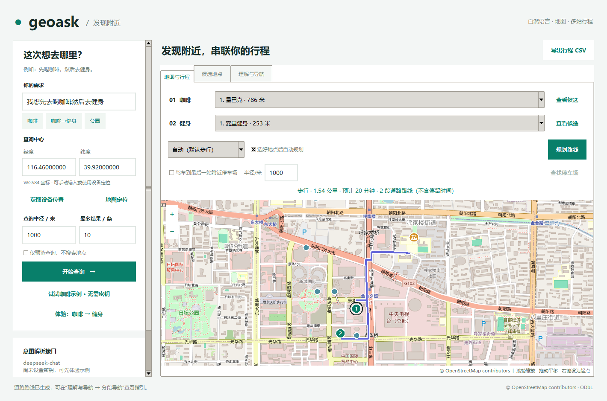
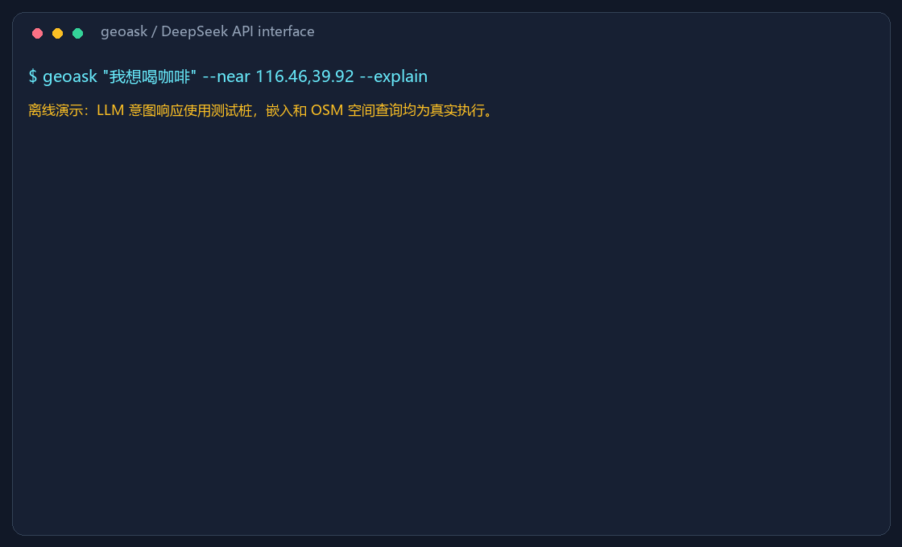

# geoask

输入一句自然语言，通过 DeepSeek 解析意图、本地嵌入匹配数据类别，再用 DuckDB spatial 查询附近地点；指定地标或门店时改用名称/别名查找。默认附近样例为北京国贸周边的真实 OpenStreetMap 数据，并附带北京实名地点目录。

**支持口语化地名、地标俗称和别名识别。** 例如输入“我想去鸟巢看演唱会”，程序能将“鸟巢”关联到真实目的地“国家体育场”，从地区数据读取坐标并规划路线；“演唱会”作为活动保留。换成其他地区数据后，也可通过文件中的别名字段、经核实的地区别名，以及模型提供的正式名称候选识别当地称呼。模型候选或多个同名地点需要用户确认；数据中找不到时会明确提示，不会凭空生成目的地或坐标。

完整代码说明：[项目代码结构与技术架构详解](docs/项目代码结构与技术架构详解.md)。包含目录与函数索引、执行流程、技术选择、设计理由、本地密钥保存、地图导航、测试和扩展说明。

## 下载已打包版本

打开 [GitHub Releases 最新版本](https://github.com/linyinan11111-dotcom/geoask/releases/latest)。Windows 10/11 x64 用户下载 `geoask-0.2.0-windows-x64.zip`，完整解压后打开 `geoask.exe`，无需安装 Python。首次类别查询需联网下载模型；正常 LLM、地图与路线功能需要网络。

Python 用户可下载 wheel 或源码包。详细步骤和附件选择见 [下载与使用说明](docs/release-download.md)。

## 桌面界面

Windows 双击 **`启动界面.cmd`**，或运行 `python geoask_gui.py`。已有虚拟环境时可直接执行 `.venv\Scripts\pythonw.exe geoask_gui.py`；安装项目后也可使用 `geoask-gui` 命令。

界面支持自然语言、多站行程、真实道路底图、设备定位、手动经纬度、候选地点切换、步行/骑行/驾车路径规划，以及行程 CSV 导出。地图可拖动、滚轮缩放，右键可设置查询起点。

在“接口设置”中填写 DeepSeek API Key，保留“保存接口和密钥到本机”勾选并点击“应用所有设置”，下次启动会自动读取，不用重复输入。也支持 `DEEPSEEK_API_KEY` 环境变量；详见下方“本地保存 API 设置”。点击“更换配置”可以切换数据集；点击“导入地区数据”可以选择新的 GeoJSON、GPKG 等文件，填写字段映射后生成独立地区配置。导入配置会保留当前接口地址、模型、底图和路径设置，供以后复用。

没有密钥时，可点击“试试咖啡示例”或“体验：咖啡 → 健身”：只固定意图解析结果，嵌入、OSM 地点查询和道路路线均为真实执行。勾选“仅预览查询”时不执行地点搜索及道路规划；后续站点依赖前站选择，因此只展示可确定中心的第一站 SQL。查询、地图下载和路线请求均在后台执行。

界面使用 Tkinter + Pillow；Pillow 已列入 Python 依赖，Tkinter 是 Python/系统组件。Linux 若未附带 Tkinter，请安装系统的 `python3-tk` 包。

界面后台服务有独立自动测试。`python scripts/verify_gui.py` 会在真实桌面窗口中联网验证地图瓦片、多站道路路线、更换地点后重算、预览、缩放和错误恢复，并更新截图。`python scripts/verify_trip.py` 只验证真实“咖啡 → 健身”查询和步行路线，不打开窗口、不调用付费 LLM。



### 获取当前位置或手动选点

点击“获取设备位置”按需请求 Windows 定位服务。系统会利用可用的 GPS、Wi-Fi 等来源提供 WGS84 坐标，界面显示精度；不会通过 IP 推测位置，也不会把北京默认点当作设备位置。只有返回有效且不超过五分钟的位置才更新输入框。请求期间若你已经手动修改坐标，不会覆盖你的输入。

如果 Windows 定位关闭、权限被拒绝或设备无可用位置，界面保留当前坐标并提示。可以在 Windows“设置 → 隐私和安全性 → 位置”中开启定位及桌面应用访问；没有 GPS 硬件的电脑也不一定能获得位置。当前验证设备返回了 `NoData`，定位失败兜底已实际运行。其他系统当前请手动输入坐标。

你始终可以直接填写经度、纬度，点击“地图定位”查看该点，或者在地图右键选起点。修改起点后重新查询，新行程才会使用新起点。**附近类别查询的样例 POI 仅覆盖北京国贸附近**；明确指定名称时另查北京实名地点目录。定位到其他城市时需要切换为相应区域的数据文件，地图服务不会自动补齐全球 POI。

### 去鸟巢看演唱会

输入“我想去鸟巢看演唱会”时，解析器保留 `place_name="鸟巢"`，把“演唱会”保留为活动，不会把它变成另一个站点或附近任意场馆。程序通过已核实别名“鸟巢 → 国家体育场”，从北京实名地点目录读取真实坐标 `(116.390286,39.991404)`，随后在地图标注并按所选方式规划道路路线。这里确认的是地点，不查询演出日程或门票。

指定名称的目的地不受 1000 米“附近类别”半径限制；距离仍相对起点或前一站计算。优先精确名称/数据别名匹配，其次核对模型提供的正式名称候选，最后匹配原名称子串。模型候选、子串匹配或多个同名地点均需要用户选择，选定前不自动规划完整路线；没找到时明确提示补充名称或切换数据，不替换成其他场馆。名称查询不加载嵌入模型。

例如“去星巴克”会显示多个候选，并把起点、当前站候选及已选站点一起纳入地图视野，状态提示“请选择具体地点”；单点自动定位最多放大到 15 级。

默认配置附带约 4.25 MiB 的 `data/beijing_places.gpkg`，含 29,131 条北京地点（其中 4,776 条汽车停车场），按名称或停车场检索时才加载。它不代表全国数据覆盖，也不扩展附近类别查询的覆盖范围。自定义数据可把 `place_catalog_path` 设为 `null`，仅搜索自己的名称/别名和停车场；也可提供自己的区域地名目录，其图层、字段映射和坐标系均可配置：

```yaml
place_catalog_path: data/beijing_places.gpkg
place_catalog_for: data/beijing_poi.gpkg
place_catalog_layer: places
place_catalog_field_mapping:
  name: name
  category: fclass
  geometry: geom
  aliases: []
place_catalog_source_crs: EPSG:4326
place_aliases:
  鸟巢: 国家体育场
```

别名配置属于当前区域的地名资料，区别于自动嵌入的类别映射。只有核实的别名才应写入，坐标始终来自数据。`place_catalog_for` 将补充目录和手工别名绑定到指定主文件；复制默认配置并更换 `geojson_path` 时，北京目录和手工别名自动停用。若需要新的补充目录，应一并更新或移除该绑定。支持名称多站行程，也能与类别站混合；后续“附近咖啡”等类别站仍要求 POI 文件覆盖该区域。

### 先喝咖啡，再去健身

1. 设置起点，输入“我想先去喝咖啡然后去健身”，开始查询。
2. DeepSeek 输出有顺序的 `GeoPlan.stops`，本地嵌入分别匹配 `cafe` 和 `fitness_centre`。没有同义词表，也不由 LLM 生成具体门店或路线。
3. 第一站在起点半径内搜索，后续站在前一站选定地点半径内搜索，默认逐站选择直线距离最近的候选。每站都可以下拉换店或通过“查看候选”选点；修改某一站会重查后续站，清除旧路线。
4. 默认自动调用 Valhalla 按道路规划。支持步行、骑行、驾车；自然语言指定方式时自动采用，也可手动覆盖。路线保持用户顺序，不重排成另一种访问顺序，也不承诺全局最短选店方案。
5. 地图显示起点、目的地和道路折线；“理解与导航 → 分段导航”显示分段距离、时间及转向指引。预计用时不包含停留时间、实时路况或交通管制，POI 代表点会吸附至可通行道路，未必是实际入口。

任一站类别匹配不足或半径内无地点时会阻止完整路线规划，后续依赖站保持未选状态。路线服务失败时保留地点选择以便重试，不用直线或驾车路线冒充步行路线。国贸默认样例实测“星巴克 → 嘉里健身”全程约 1.54 公里、20 分钟，两段真实步行道路路线；LLM 部分在该免密钥演示中使用固定测试桩。

### 可选：导航到目的地附近停车场

在“地图与行程”勾选 **“驾车到最后一站附近停车场”**，默认关闭。先选定全部行程地点，再查找最后一站周边的汽车停车场，默认半径 1000 米，可在 1–5000 米范围内调整。下拉列表按距最后一站的 WGS84 直线距离排序，支持有名称和未命名停车场；选择一个后点击“规划路线”。

列表同时显示匹配总数；超过“最多结果”时说明只显示最近若干个，可缩小半径或增大结果上限。未命名停车场附带经纬度，结合地图标记区分。查询期间禁用“仅预览”和“自动规划”开关，避免界面选项与已提交请求不一致。

停车模式使用真实驾车道路路线，将最后一段终点改为所选停车场，保留前面各站和原目的地记录；地图用 `P` 标注停车场，用站点编号标注原目的地。“分段导航”会说明实际驾车终点及停车场到原目的地的直线距离，这段距离不等于步行路线。关闭选项后恢复原来的出行方式；更换站点或地区会清除旧停车场选择和路线。更改停车半径后再次规划会重新查找并要求选择。

停车场来自当前数据和当前地区的补充目录，不由 LLM 生成；没有记录时提示增大半径或切换数据，不使用其他地区停车场兜底。北京示例补充目录已包含从交通点、面图层提取的汽车停车场，排除自行车停车区。其他地区的数据需要类别字段中实际包含停车场；可在地区配置中指定自己的类别值：

```yaml
parking:
  categories: [parking, parking_underground, parking_multistorey, 停车场]
  radius: 1000
```

数据不提供实时车位、收费、开放时间或准入保证；部分场地可能限制进入。停车场几何代表点未必是车辆入口，道路规划会吸附到可通行道路。CSV 导出保留用户原始行程目的地。

直接输入“附近停车场”时，按当前主数据中实际存在的 `parking.categories` 类别查询，不加载嵌入模型，也不会映射为 `park`（公园）；支持自定义停车类别。默认国贸主数据没有停车类别，会提示切换含停车场的数据；GUI 还可先选目的地，再启用上述停车导航，查询补充目录。单站和多站采用同一规则。“有停车位的咖啡店”“停车方便的餐厅”等仍按咖啡/餐厅查询，停车修饰条件会显示为未应用，不能保证有车位。解析器返回“不明确 / unknown / 未知”时停止查询并提示补充需求。

### 地图与路线 API

默认底图为 [OpenStreetMap Standard](https://tile.openstreetmap.org/)，路线为 [Valhalla 公共实例](https://valhalla1.openstreetmap.de/)，均免 API Key、需要网络。公共服务可能限流或不可用；可在“接口设置 → 地图与路径 API”替换并保存兼容服务，或修改配置：

```yaml
map:
  tile_url: https://tile.openstreetmap.org/{z}/{x}/{y}.png
  attribution: © OpenStreetMap contributors
  user_agent: geoask/0.2 (local desktop nearby search)
routing:
  endpoint: https://valhalla1.openstreetmap.de/route
  timeout_seconds: 20
```

底图接口要求 256×256 XYZ、Web Mercator / WGS84。未经坐标适配不能直接套用高德 GCJ-02 或百度 BD-09 底图，否则与 WGS84 POI 错位。路径接口为 Valhalla 格式，`walking/cycling/driving` 分别映射到 `pedestrian/bicycle/auto`。可自部署 Valhalla；其他厂商路径 API 需实现独立适配器。

请求在 `directions_options` 中指定 `language: zh-CN` 和 `units: kilometers`。当前公共 Valhalla 服务会把中文回退为英文；此时程序根据服务返回的转向类型、道路名称、方向和距离生成本地中文模板指引，并在导航面板标注来源。中文模板保留原道路名称；未知转向类型提示沿地图路线行进。

返回的路线单位会校验；自部署服务返回 `miles` 时转换为米，未知单位拒绝使用。起步方向优先读取实际响应的 `bearing_after`。

底图仅下载可见区域，两个后台下载线程，磁盘缓存七天，启动及切换底图时按时间/128 MiB 容量上限清理，不批量预抓。源码配置默认为 `.cache/tiles`，普通安装使用用户缓存目录的 `tiles`；可离线显示已缓存瓦片；新区域底图与道路规划仍需要网络。地图瓦片请求会向所选服务透露可见区域，路径请求发送起点和所选站点；LLM 只接收查询原文，不接收设备坐标或 POI 数据。请遵守 [OSM 瓦片使用政策](https://operations.osmfoundation.org/policies/tiles/)，公开部署或大量使用建议换成自托管或有配额的服务。



演示中的 LLM 响应使用固定测试桩；嵌入模型、地点和米制距离均为真实执行。可运行 `python scripts/demo.py` 复现，无需 API 密钥。

## 快速开始

Python 3.11–3.13（`>=3.11,<3.14`，与锁定依赖的支持范围一致）。进入本目录，在 PowerShell 中执行三条命令：

```powershell
python -m pip install -r requirements.txt -e .
$env:DEEPSEEK_API_KEY="你的密钥"
geoask "我想喝咖啡" --near 116.46,39.92 --explain
```

Bash 第二条命令换成 `export DEEPSEEK_API_KEY="你的密钥"`。推荐事先创建并激活虚拟环境；Windows 为 `python -m venv .venv`，然后 `.\.venv\Scripts\Activate.ps1`。

仓库已附带约 156 KB 的附近样例 GPKG 和约 4.25 MiB 的北京地点及停车场目录，不需要下载完整北京数据。首次运行需联网安装 DuckDB spatial，类别查询还需下载多语言嵌入模型（FastEmbed 标注约 0.22 GB），后续使用本地缓存。正常自然语言查询每次仍会请求配置的 LLM API。

普通 `pip install .` 或 wheel 安装同样包含默认配置、OSM 数据、清单和 Windows 定位脚本，资源通过 `importlib.resources` 定位。已安装版本的缓存写入用户目录（Windows：`%LOCALAPPDATA%/geoask`；其他系统：`$XDG_CACHE_HOME/geoask` 或 `~/.cache/geoask`），不会写入 site-packages。源码运行和自定义配置的缓存路径仍由 `cache_dir` 决定。

从旧版 editable 安装升级后，请在同一虚拟环境重新执行 `python -m pip install -e .`，以注册新增的 `geoask_resources` 包和入口。只更新源码不会刷新安装元数据。同一份配置使用相对或绝对 `--config` 路径时共享缓存；源码的 `--config config.yaml` 不会自动迁移到用户缓存目录。

没有安装命令入口时，也可以 `python geoask.py "我想喝咖啡" --explain`。

CLI 无法理解意图、类别不匹配、查询无结果或输入无效时返回非零退出码；成功输出和有效 `--dry-run` 返回 0。

```text
geoask QUERY [--near 经度,纬度] [--radius 米] [--limit 条数]
             [--explain] [--dry-run] [--config 配置路径]
```

`--near` 使用 WGS84，经度在前；默认中心为 `(116.46,39.92)`，位于国贸附近，并非西单。默认半径 1000 米，最多 10 条，支持半径上限 100 公里。地图提供的 GCJ-02/BD-09 坐标需先转换为 WGS84。

`--dry-run` 完成意图解析、数据加载和类别映射，打印带 `?` 的 SQL 及独立绑定参数，不执行最终邻近查询；它仍会调用 LLM，并可能首次下载模型。映射被拒绝时列出可用类别，不生成查询。

## DeepSeek / OpenAI / 本地接口

### 本地保存 API 设置

1. 打开界面的“接口设置”，填写接口地址、模型、API Key。
2. 勾选 **“保存接口和密钥到本机，下次自动读取”**（默认勾选），点击任一页面的“应用所有设置”。同时保存 LLM、底图和路径接口参数。
3. 下次正常启动默认配置时，恢复上述接口参数与密钥。切换到自定义地区配置时尊重该配置的接口参数，只有接口地址及密钥环境变量一致才自动复用保存的密钥。

Windows 文件位于 `%LOCALAPPDATA%\geoask\connection.dat`，使用 Windows DPAPI 按当前用户加密；文件复制给其他 Windows 用户通常无法解密。Linux 位于 `${XDG_CONFIG_HOME:-~/.config}/geoask/connection.dat`，macOS 位于 `~/Library/Application Support/geoask/connection.dat`；这些系统当前使用权限为 `0600` 的明文文件，界面会说明，不声称系统加密。

仅保存一组当前接口，不维护多账号列表。界面本次输入优先于环境变量；自动恢复的密钥优先级低于环境变量。CLI 仍从所选 YAML 读取接口地址和模型，密钥按“环境变量 → 匹配接口的本地保存”读取；保存了自定义服务后，CLI 应选择同一服务的配置文件。

取消勾选再应用会删除本地保存，仅本次使用；点击 **“清除本地保存的接口和密钥”** 会立即删除文件并清空当前密钥，不删除环境变量。普通退出不会清除已保存内容。保存失败会保留对话框和原会话状态；损坏或无法解密时提示清除后重存。

真实密钥不写入仓库 `config.yaml`、地区导出、CSV 或查询 SQL；本地文件在用户目录，另有 `.gitignore` 防止误放入仓库的同名文件被提交。加密保护的是磁盘文件，不能阻止同一已登录用户的程序读取密钥。测试与 GUI 验证脚本使用隔离临时路径，不覆盖用户真实设置。

CLI 接口保留在 `parse_intent(query, settings, client=None)`；GUI 使用 `parse_plan(query, settings, client=None)` 解析有顺序的多站行程。两者的 `client` 均可注入便于替换与测试。默认 `config.yaml`：

```yaml
llm:
  base_url: https://api.deepseek.com
  model: deepseek-chat
  api_key_env: DEEPSEEK_API_KEY
  response_format: json_object
  timeout_seconds: 30
```

DeepSeek 使用 JSON 模式，系统提示中明确要求 JSON，响应再经过 Pydantic 校验，拒绝额外字段、空意图、不完整结果和无效 JSON。输出只包含：

```json
{"intent":"餐厅","modifiers":["安静"],"place_name":null}
```

要使用 OpenAI，可替换为以下配置，并设置 `OPENAI_API_KEY`：

```yaml
llm:
  base_url: https://api.openai.com/v1
  model: gpt-4o-mini
  api_key_env: OPENAI_API_KEY
  response_format: structured
  timeout_seconds: 30
```

`structured` 使用 SDK 的 `chat.completions.parse(response_format=GeoIntent)`，参见 [official OpenAI documentation](https://developers.openai.com/api/docs/guides/structured-outputs)。本地兼容服务可修改 URL、模型和密钥环境变量名，按服务能力选择 `json_object` 或 `structured`。密钥可来自本次输入、环境变量或匹配接口的本地保存，不写入数据配置或打印到终端；本地服务若不验证密钥，可设置一个占位值。

“安静”“适合约会”等修饰词会被解析和展示，但样例没有相应属性，不参与筛选，CLI 会明确提示未应用。LLM 不接收地点数据库，也不能提供 SQL 或决定最终类别。`place_name` 仅记录用户明确指定的名称；旧接口省略该字段时仍兼容为类别查询。新接口应始终输出该字段，未指定时为 `null`。可选 `place_candidates` 最多包含 4 个同一目的地的正式名或跨语言名称，必须在当前数据中精确找到，且需要用户确认后才能导航；模型不能返回坐标。

GUI 的行程响应同样经过严格校验，例如：

```json
{"stops":[{"intent":"演唱会","modifiers":[],"place_name":"鸟巢"}],"travel_mode":"walking"}
```

## 换成自己的数据

GUI 中点击“导入地区数据”，选择区域文件，填写名称、类别、几何字段、图层、源 CRS，点击“验证并导入”并另存为新的 YAML 配置。常见 GeoJSON 的几何列在 DuckDB 中为 `geom`；GPKG 请按实际图层填写。程序在后台验证数据、坐标和字段后才保存配置，并清除旧地区目录、别名、候选和路线；失败时保留当前地区。新起点使用文件中首个有效地点，之后可手动修改或获取设备位置。不会调用 LLM 或下载嵌入模型来导入数据。

也可以修改配置文件的数据路径与映射；相对路径按配置文件所在目录解析：

```yaml
geojson_path: data/my_places.geojson   # 历史键名，也支持 GPKG 等 ST_Read 格式
layer: null                          # GPKG 多图层文件请明确指定图层
field_mapping:
  name: name
  category: amenity
  geometry: geom
  aliases: [别称]                    # 可选：额外的简称/别名列，必须存在
source_crs: EPSG:4326                 # 投影数据请填写真实源 CRS，例如 EPSG:3857
place_catalog_path: null              # 仅使用新文件的名称/别名
place_catalog_for: null
place_aliases: {}
```

正式名称从 `field_mapping.name` 读取，常见 `alt_name`、`short_name`、`official_name`、`old_name`、`loc_name`、`int_name`、`alias/aliases`、`name:zh/name:en` 等列自动保留。别名列支持数组，或使用 `;`、`；`、`|` 分隔的字符串。自定义“别称”“英文名”等字段写入 `field_mapping.aliases`；没有额外字段时用 `aliases: []`。如“广州塔”记录的 `alt_name` 为“小蛮腰”，查询“小蛮腰”就会返回该记录，不需要修改代码或维护全国别名表。

读取前用元数据核对图层名，大小写不一致时解析到真实图层，不存在则列出可用图层；不会把未核实名称传入 `ST_Read`。字段映射同样忽略大小写。混合数组/字符串别名的每个元素都拆分并清理空值；空的手工别名映射会被拒绝。名称及查询统一处理全角字符、全角空格和 NBSP。损坏文件、无效 CRS 或非几何字段会给出中文修正提示，原始异常保留在日志中。

没有类别列时设 `category: null`，GUI 对应输入框留空。此时仍能查询具体地标、门店和别名，但不能按“附近咖啡”等类别查找。没有名称/类别的记录不会被虚构补齐。对于数据中未记录的俗称，DeepSeek 可提出正式名候选（例如“小蛮腰 → 广州塔”），程序只核对该名称是否存在于当前数据中，并提示用户确认；既没名称也没对应记录时会明确未找到。更换区域不保证数据不存在的目的地也能查到。

不要猜字段名。可先检查元数据与类别：

```python
import duckdb
con = duckdb.connect()
con.execute("INSTALL spatial; LOAD spatial;")
print(con.execute("SELECT * FROM ST_Read_Meta(?)", ["data/my_places.gpkg"]).fetchall())
from geoask import resolve_layer
layer = resolve_layer(con, "data/my_places.gpkg", "poi")
print(con.execute("DESCRIBE SELECT * FROM ST_Read(?, layer = ?)",
                  ["data/my_places.gpkg", layer]).fetchall())
print(con.execute("SELECT fclass, count(*) FROM ST_Read(?, layer = ?) GROUP BY fclass",
                  ["data/my_places.gpkg", layer]).fetchall())
```

程序将源 CRS 转为 WGS84，并用 `ST_PointOnSurface` 把面或线转换为代表点，统一计算到代表点的距离。它不计算到门口、最近边界或沿道路的路程。中文类别也可直接使用；如果更换嵌入模型，请重新评估阈值。

## 设计说明

1. **意图与 SQL 分离。** LLM 只输出 `GeoIntent` 或含有顺序的 `GeoPlan`，分开记录类别/活动和具体目的地。字段名来自本地配置并进行标识符转义，类别由数据集词表映射产生，所有名称、类别、坐标、半径与数量值均用绑定参数传递。用户原文不进入 SQL。
2. **本地跨语言映射。** 使用 FastEmbed 的 `sentence-transformers/paraphrase-multilingual-MiniLM-L12-v2`，在 CPU 上生成向量并计算余弦相似度。英文单语的 `bge-small-en-v1.5` 无法可靠完成中文到英文的类别匹配，因此默认采用多语言模型。类别从数据自动提取，无硬编码同义词表。缓存键包含模型名、预处理方式和完整类别词表，换数据类别后自动失效。
3. **有条件地接受匹配。** 默认相似度至少 0.60，且领先第二名至少 0.03，否则列出可用类别。相似度不是概率。本样例实测“咖啡”→ `cafe` 约 0.773，“火锅”最近类别约 0.477，被拒绝。这个结果依赖模型和类别词表，不能保证任何数据集上的细分类别都会被拒绝；不要把通用 `restaurant` 当作已验证的火锅店。
4. **真实米制距离。** 每个连接都设置 `geometry_always_xy = true`，统一使用经度、纬度。`ST_Distance_Spheroid` 计算 WGS84 椭球距离并返回米；普通 `ST_Distance` 在经纬度上给出的是角度坐标下的平面距离，不能直接当米。
5. **索引筛选后精确过滤。** WGS84 `GEOMETRY` 上的 `ST_DWithin` 距离参数使用坐标单位，**不是默认米**。本实现先以保守的经纬度包围框运行 `ST_Intersects`，利用 R-Tree 缩小候选，再执行 `ST_Distance_Spheroid <= radius`，按距离升序排列。测试通过参数化 `EXPLAIN` 确认 `RTREE_INDEX_SCAN`，并覆盖跨日期变更线和极区。
6. **按需加载。** 每次启动在内存中加载选定的小数据集，然后建 R-Tree。无需数据库服务；不加载全球 OSM。全局或大型数据应先裁剪，启动耗时仍会随输入文件增长。

## 数据来源与许可

数据来源为 [Geofabrik 北京下载](https://download.geofabrik.de/asia/china.html)，基于 **© [OpenStreetMap contributors](https://www.openstreetmap.org/copyright)**。数据库与裁剪后的衍生数据库遵循 [ODbL 1.0](https://opendatacommons.org/licenses/odbl/1-0/)。分发或公开使用衍生数据库时请保留署名并遵守 ODbL；数据许可与本项目代码的 MIT 许可分别适用。

附带样例取自 2026-10-20 的 [北京 GPKG 归档](https://download.geofabrik.de/asia/china/beijing-261020-free.gpkg.zip)。国贸周边范围为 `[116.44,39.904,116.48,39.936]`，合并点 POI、面 POI 和交通图层，保留原始类别：

| 类别 | 数量 |
| --- | ---: |
| cafe | 88 |
| restaurant | 258 |
| park | 21 |
| railway_station | 12 |
| supermarket | 22 |
| fitness_centre | 14 |

合计 415 条，其中 307 条有非空名称。交通源图层使用 `railway_station`，没有凭空改写为 `subway_station`。保留 `osm_id` 和 `source_layer` 便于溯源；公园等面要素使用代表点。OSM 数据完整性与时效性不作保证，不伪造门店或距离。

`data/manifest.json` 记录原始包 SHA-256、裁剪范围、类别统计和当前数据 SHA-256；`data/GEOFABRIK_README.txt` 保留下载包说明。重新准备真实数据：

```bash
python scripts/prepare_data.py
python scripts/prepare_places.py
```

脚本按需下载约 72 MB 的日期固定归档，并校验固定 SHA256；归档布局变化时明确报错。解压缓存按大小和 CRC 校验，损坏或中断产生的缓存重新提取。裁剪与国家体育场唯一性校验、GPKG 回读检查均在发布前完成；清单采用临时文件后原子替换，清单发布失败会回滚数据。数据与清单两个文件不构成断电事务，进程被杀后应检查清单哈希或重新生成。归档未来可能被上游清理；若 URL 失效，请更换为明确日期的新归档并一并更新固定校验值。GPKG 写入时间等元数据可能导致重新生成的二进制校验值不同，内容和裁剪步骤可复现。

两个脚本支持 `--output-dir 路径`。`python scripts/verify_data.py` 在系统临时目录重建两份数据，核对清单、数据统计及鸟巢记录，不覆盖仓库样例，报告保存到 `docs/data-verification.json`；没有缓存归档时仍需联网下载。

地名目录同样来自该归档，保留有名称的北京点/面 POI 和交通地点，另从 `gis_osm_traffic_free`、`gis_osm_traffic_a_free` 提取汽车停车场（包括未命名停车场）；排除公交站与出租车点，不提取自行车停车区，按 `osm_id/name` 去重，面取代表点。共 29,131 条地点，4,776 条类别为 `parking`。与附近样例适用相同 ODbL 许可。`data/places-manifest.json` 记录来源、哈希、条数及鸟巢对应的 OSM ID `152301551`。目录代表点未验证为场馆或停车场入口。

## 测试

```powershell
python -m pip install -r requirements-dev.txt
python -m pytest -q
$env:GEOASK_MODEL_TESTS="1"; python -m pytest -q
```

演示与真实模型测试首次也需要下载模型，并非首次启动即可离线使用。默认跳过真实模型测试，避免自动下载；空间测试首次需要联网安装扩展。启用 `GEOASK_MODEL_TESTS=1` 后覆盖真实中文类别匹配（包括咖啡和健身）。测试不调用付费 API；通过 mock 和本地 HTTP 兼容服务验证 DeepSeek 单站/多站请求与 JSON 响应，覆盖无效输出、安全预览、米制距离、索引、缓存、选点和后续站更新、三种 Valhalla 模式、polyline 解码、错误路线响应、定位过期及权限失败、底图投影等。

名称回归还覆盖鸟巢/国家体育场别名、超出附近半径的目的地、同名地点显式选择、未找到时不替换场馆、名称注入、名称预览不执行查询，以及 CLI 不加载类别模型。GUI 验证脚本还会用固定解析响应测试鸟巢的真实地点与道路路线，保存 `docs/gui-named-place.png`；固定解析响应不代表已调用真实 DeepSeek。

跨地区测试使用明确标注的上海、广州、东京模拟 GeoJSON，验证名称/数组别名/跨语言字段、无类别的地标、投影目录、自定义字段、模型候选确认、文件更新及地区切换后的索引重建、北京补充目录隔离、导入失败不落盘等。GUI 验证还通过真实导入对话框和后台导入队列测试广州模拟文件，保存 `docs/gui-import.png` 和 `docs/gui-region.png`。这些模拟文件用于功能验证，不作为真实 POI 数据发布。

停车场测试覆盖以最后一站为搜索中心、距离排序、未命名停车场、自行车停车区排除、自定义地区类别/目录、半径边界、预览和未选定站点禁止查询、空结果，以及仅替换最终驾车终点。GUI 验证使用鸟巢附近真实停车场和 Valhalla 驾车道路路线，保存 `docs/gui-parking-route.png`，并检查无结果及关闭停车模式后的状态恢复。

`requirements.txt` 锁定直接运行依赖，`requirements-dev.txt` 增加 pytest（Pillow 同时用于界面和演示）。`requirements.lock.txt` 为本次 Windows / Python 3.13 验证环境的完整依赖快照。重新生成演示图：`python scripts/render_demo.py`；可用 `--font 中文字体文件` 或 `GEOASK_FONT` 指定字体。


### 异常恢复与安装验证

GUI 和地图队列逐事件隔离异常，并始终重新安排轮询；后台请求携带代际标识，地区切换或新查询后忽略过期响应。查询失败时清空旧站点控件。后台及界面异常保留 traceback，滚动日志位于用户缓存目录 `logs/geoask.log`（单文件 2 MB，保留 3 份备份）；日志不主动记录 API Key 或完整请求对象。

类别向量缓存无效、空文件、错误格式或维度不符时重建。字段映射忽略大小写，别名会清理空白/null。地区配置、CSV 和瓦片写入采用同目录临时文件后替换；瓦片下载成功但无法写缓存时仍显示。地区配置禁止覆盖现有文件，不依赖硬链接。

新配置使用系统的原子且不覆盖的重命名操作；不预先创建空目标，多个写入者只能有一个成功，不支持该操作的文件系统会提示换目录。文件清理失败会记日志并保留原始异常；已有文件的 POSIX 权限位会保留。日志首次初始化有线程锁，异常队列事件也不会中断后续事件。断电持久性、多个文件的原子提交和多个进程共享滚动日志不在保证范围内。

描述词限制为最多 16 个、每个 1–100 字符。响应必须完整结束；多站解析必须显式给出出行方式。切换为 E5 模型时采用查询 `query:`、类别 `passage:` 前缀并重新建立类别缓存；默认多语言 MiniLM 模型不受影响。

`tests/test_reliability.py` 提供无头 GUI/地图队列、异常恢复、过期事件、设置表单、缓存写失败、时间戳、定位 subprocess 和导入失败测试。示例数量与地标坐标从数据 manifest 读取。GitHub Actions 配置 Windows/Linux × Python 3.11、3.12、3.13；当前本机验证为 Windows / Python 3.13，其他矩阵需由 CI 实际执行。

`tests/test_review_round2.py` 覆盖图层原生崩溃的子进程回归、停车语义、别名和导入错误等；`tests/test_gui_wiring.py` 创建真实 Tk 控件，替换地图网络与工作线程，检查 `_show_result`、两页 Apply、代际接线和换点失败恢复，无需 HTTP 或模型。Linux 用 `xvfb-run -a python -m pytest -q`；CI 显式安装 `python3-tk`/Xvfb，并将缺失显示环境视为失败。真实 GUI 验证脚本使用系统临时目录，不要求检出后已有 `.cache/`，但首次模型下载和网络服务仍需可用。

构建并在仓库外普通安装验证（依赖复用当前解释器，CI 先全新安装依赖）：

```powershell
python -m pip install setuptools wheel
python -m pip wheel . --no-deps --no-build-isolation --wheel-dir dist
python scripts/verify_wheel.py dist/geoask-0.2.0-py3-none-any.whl
```

安装冒烟会验证打包资源、真实 GPKG 加载、CLI 入口和本地 HTTP 兼容接口；Windows 上还初始化并关闭安装后的 GUI。真实桌面验证记录 `docs/gui-verification.json` 包含时间戳和生产代码 SHA256，检查模糊候选可见、轮询异常恢复、实际缩放、设置跨页保存、中文模板、道路路线和停车导航。`gui.png` 是初始界面，`gui-route.png` 是路线界面。
