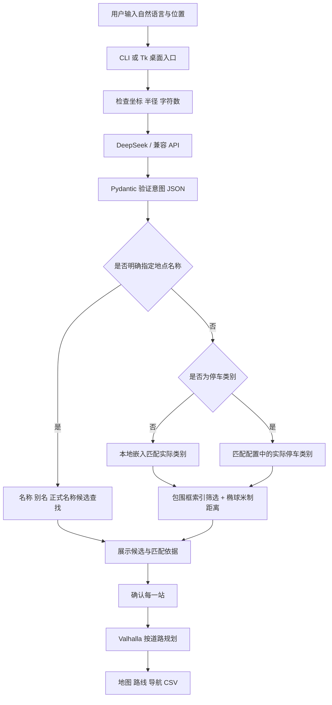
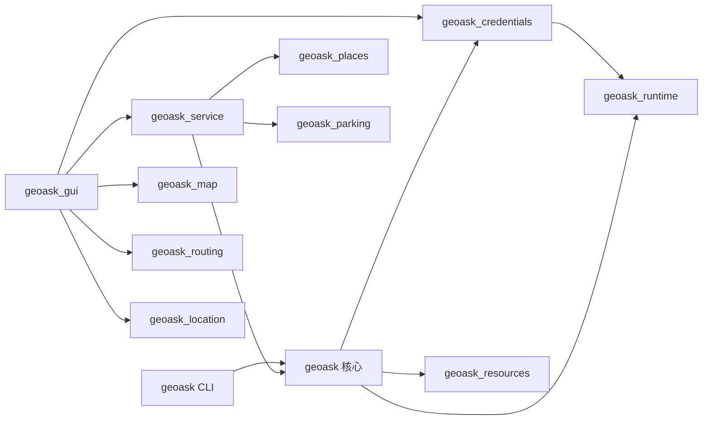
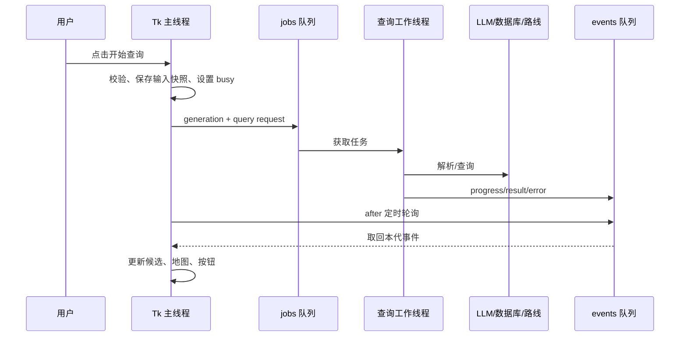

# geoask 项目代码结构与技术架构详解

> 文档日期：2026-10-26。基于当前工作区源码，包括 API 本地保存功能。
>
> 这是一份可以从零阅读的项目技术说明：既解释“文件里有什么”，也解释“为什么分成这些文件”“输入怎样变成结果”“哪些能力已经实现、哪些没有”。代码入口以实际文件、类和函数名为准。审查报告中的旧截图、旧测试数量和原始规划不作为当前实现的替代说明。

## 阅读导航

1. [项目定位和能力边界](#1-项目定位和能力边界)
2. [整体架构](#2-整体架构)
3. [完整目录结构](#3-完整目录结构)
4. [技术栈与依赖](#4-技术栈与依赖)
5. [程序启动与入口](#5-程序启动与入口)
6. [核心数据模型](#6-核心数据模型)
7. [配置与文件路径](#7-配置与文件路径)
8. [API 本地保存和凭据管理](#8-api-本地保存和凭据管理)
9. [自然语言理解](#9-自然语言理解)
10. [嵌入语义匹配](#10-嵌入语义匹配)
11. [空间数据加载](#11-空间数据加载)
12. [空间索引与米制查询](#12-空间索引与米制查询)
13. [地名和别名识别](#13-地名和别名识别)
14. [多站行程服务](#14-多站行程服务)
15. [GUI 与线程模型](#15-gui-与线程模型)
16. [地图底图](#16-地图底图)
17. [设备定位](#17-设备定位)
18. [道路规划](#18-道路规划)
19. [停车场导航](#19-停车场导航)
20. [地区导入](#20-地区导入)
21. [公共运行设施](#21-公共运行设施)
22. [数据准备流水线](#22-数据准备流水线)
23. [安装、资源和分发](#23-安装资源和分发)
24. [测试和验证](#24-测试和验证)
25. [关键场景的执行过程](#25-关键场景的执行过程)
26. [各模块函数和方法职责索引](#26-各模块函数和方法职责索引)
27. [为什么这样设计](#27-为什么这样设计)
28. [限制、风险与扩展路线](#28-限制风险与扩展路线)
29. [开发、排错与阅读顺序](#29-开发排错与阅读顺序)
30. [面试和项目讲解参考](#30-面试和项目讲解参考)

---

## 1. 项目定位和能力边界

### 1.1 它是什么

geoask 是一个运行在本机的自然语言地理查询工具，同时提供命令行和桌面界面。用户输入“我想喝咖啡”，系统解析出活动类别，在当前数据里确定实际类别代码，然后根据用户位置查找附近地点。

如果用户输入“我想去鸟巢看演唱会”，系统需要识别明确的目的地“鸟巢”，按名称或别名查找真实场馆，而不是把“演唱会”映射为附近任意娱乐场所。这个区别决定了项目需要两条检索路径。

如果输入“先喝咖啡，再去健身”，系统保留顺序，选择各站候选，随后调用道路路线服务。用户可以更换候选，也可以选择驾车到最后一站附近停车场。

### 1.2 它不是一个独立的全国地图数据库

地图底图、地点数据、道路规划、自然语言解析是四类不同资源：

| 资源 | 当前来源 | 提供什么 | 不提供什么 |
| --- | --- | --- | --- |
| 地点数据 | 用户选定的 GeoJSON/GPKG 等文件 | 名称、类别、几何、别名 | 数据未收录的全国目的地 |
| 语言模型 | DeepSeek 或兼容接口 | 意图、顺序、明确名称、名称候选 | 可信坐标、查询 SQL、实际道路 |
| 地图底图 | XYZ 瓦片 API | 地图背景图像 | 当前数据库的 POI 补齐 |
| 道路服务 | Valhalla API | 路线几何、路程、时间、转向 | 实时停车空位、场馆演出安排 |

因此地图能显示上海，并不代表默认北京 POI 数据能查询上海咖啡馆。更换区域必须提供相应数据，或者实现额外的在线地点服务适配器；后者目前没有内置。

### 1.3 当前实现的主要功能

- CLI：自然语言查询、默认/手工坐标、半径、结果上限、解释、SQL 预览、指定配置。
- GUI：输入需求、设备定位、地图右键设起点、候选表格、候选选择、地图视野适配。
- 类别检索：本地多语言嵌入、余弦相似度、阈值及第一/第二名差距。
- 名称检索：真实名称、数据别名、核实过的配置别名、模型名称候选确认。
- 多站行程：最多六站，保持用户顺序，前一站选点影响后续站搜索。
- 道路规划：步行、骑行、驾车，中文模板指引与路线折线。
- 停车导航：最后一站附近停车场搜索，驾车终点替换，保留原目的地。
- 地区导入：字段和图层适配、源 CRS 转换、独立地区 YAML。
- 本地 API 保存：接口参数、密钥保存、启动恢复、匹配服务取密钥、一键删除。
- 工程设施：日志、异常隔离、代际 ID、原子写、资源打包、自动测试和验证脚本。

## 2. 整体架构

### 2.1 从用户需求到结果的全链路



这里 LLM 的输出在“意图 JSON”处结束。SQL、坐标选择、阈值判断、路线调用由程序控制；模型没有获得数据库执行权限。

### 2.2 分层和职责

| 层 | 对应文件 | 负责的事 |
| --- | --- | --- |
| 交互层 | `geoask_gui.py`、`geoask.py:cli`、`启动界面.cmd` | 用户输入、展示、控件状态、命令参数 |
| 应用服务层 | `geoask_service.py` | 一次查询/多站选点/换点/停车查找的流程编排 |
| 查询领域模块 | `geoask.py`、`geoask_places.py`、`geoask_parking.py` | 解析模型、类别匹配、空间 SQL、名称排序、停车规则 |
| 外部服务适配 | `geoask_routing.py`、`geoask_location.py`、`geoask_map.py` | 道路 API、系统定位、地图瓦片 |
| 基础设施 | `geoask_runtime.py`、`geoask_credentials.py`、`geoask_resources/` | 日志、原子文件、凭据、安装资源 |
| 数据维护 | `geoask_data.py`、`scripts/` | 地区导入、固定来源提取、验证报告 |
| 质量保障 | `tests/`、`.github/workflows/tests.yml` | 单元、集成、安装和跨环境验证配置 |

这是一个模块化本地应用，并没有引入 HTTP 后端、前端框架、容器或远程数据库。层次主要通过 Python 模块和数据对象表达，不靠部署多个服务表达。

### 2.3 依赖方向与现实取舍



核心模型目前放在 `geoask.py`，其他模块统一复用，避免每个文件定义不同的配置结构。小项目这样最容易保持一致。代价是 `geoask.py` 仍然同时承载配置、解析、查询和 CLI，规模继续扩大时适合拆出 `models.py`、`config.py`、`intent.py`、`spatial.py`。

存在少量相互引用，例如停车模块引用行程结果类型，而服务需要停车功能。服务在需要时局部导入停车函数，避免模块初始化时形成循环导入。局部导入是当前可工作的取舍，不代表依赖关系已经完全单向。

## 3. 完整目录结构

```text
geoask/
├── geoask.py                       核心配置、意图、嵌入、空间查询、CLI
├── geoask_service.py               GUI/程序调用共用的查询与行程服务
├── geoask_gui.py                   Tk 桌面窗口、事件、交互状态
├── geoask_map.py                   XYZ 瓦片、投影、拖动缩放、标记绘制
├── geoask_places.py                明确目的地的名称与别名查询
├── geoask_parking.py               目的地周边停车场和终点替换
├── geoask_routing.py               Valhalla 请求、路线解码、中文指引
├── geoask_location.py              Windows 定位调用与结果检查
├── geoask_data.py                  新地区数据验证、生成配置
├── geoask_runtime.py               缓存目录、日志、原子写、事件隔离
├── geoask_credentials.py           本地接口设置与密钥保存
├── geoask_resources/
│   └── __init__.py                 安装资源定位、版本号
├── config.yaml                    默认数据、模型、地图、路线配置
├── requirements.txt               固定直接运行依赖
├── requirements-dev.txt           测试依赖
├── requirements.lock.txt          Windows/Python 3.13 环境快照
├── pyproject.toml                  项目信息、模块、入口、构建配置
├── setup.py                        构建时复制标准资源
├── MANIFEST.in                     sdist 资源及脚本清单
├── 启动界面.cmd                    Windows 双击入口
├── README.md                       安装、操作、简要设计说明
├── LICENSE                         代码 MIT 许可证
├── .gitignore                      缓存、虚拟环境、构建产物等忽略规则
├── .gitattributes                  Windows 启动脚本行尾规则
├── .github/workflows/tests.yml     Windows/Linux × Python 版本矩阵
├── data/
│   ├── beijing_poi.gpkg            国贸附近类别查询样例
│   ├── beijing_places.gpkg         北京地名及停车场补充目录
│   ├── manifest.json              主样例来源、哈希和统计
│   ├── places-manifest.json       目录来源、哈希、类别、核实别名
│   └── GEOFABRIK_README.txt        上游数据说明和署名
├── scripts/
│   ├── data_pipeline.py           固定归档校验、解压、数据/清单发布
│   ├── prepare_data.py            提取附近查询样例
│   ├── prepare_places.py          提取地名目录与停车场
│   ├── inspect_named_places.py    开发时检查源数据名称分布
│   ├── get_location.ps1           Windows .NET 定位桥接
│   ├── demo.py                    固定意图、真实类别/空间查询演示
│   ├── render_demo.py             根据演示输出生成图片/GIF
│   ├── verify_gui.py              真实桌面、瓦片、路线验证与截图
│   ├── verify_trip.py             真实多站查询和步行道路验证
│   ├── verify_data.py             临时重建数据并核对统计/哈希
│   └── verify_wheel.py            仓库外安装和入口冒烟验证
├── tests/
│   ├── conftest.py                隔离用户真实凭据存储
│   ├── test_credentials.py        本地保存、加密、重启、清除测试
│   ├── test_api_interface.py      本地 HTTP 兼容接口集成测试
│   ├── test_geoask.py             意图、映射、空间查询核心测试
│   ├── test_gui_service.py        无界面的服务、导出和失败处理
│   ├── test_gui_wiring.py         真正 Tk 控件和事件接线测试
│   ├── test_named_places.py       真实地标、同名、注入、预览
│   ├── test_regions.py            跨地区字段、别名、投影、导入
│   ├── test_parking.py            停车规则、排序、终点替换
│   ├── test_travel.py             多站选点、路线解码、模式验证
│   ├── test_reliability.py        第一批可靠性回归
│   ├── test_review_round2.py      图层崩溃、停车守卫、别名等回归
│   └── test_p3.py                 并发、原子发布、数据准备等回归
├── docs/
│   ├── 项目代码结构与技术架构详解.md  本文
│   ├── api-local-storage.md       本地 API 保存变更与验证
│   ├── gui*.png                   界面/候选/路线/导入/设置截图
│   ├── demo.gif / demo.png        演示产物
│   ├── *verification.json        各类验证证据
│   └── review*.md                 审查原报告和修复记录
├── .cache/                       本地模型、类别向量、瓦片等；不提交
├── .downloads/                   日期固定的归档及源 GPKG；不提交
├── .venv/                        本地 Python 环境；不提交
├── build/ / dist/                构建中间文件与安装包；不提交
└── geoask.egg-info/               安装元数据；不提交
```

`geoask_resources/` 在源码中只有资源工具和版本号；构建 wheel 时才把标准 `config.yaml`、`data/` 和定位脚本复制到它下面。这样不用在仓库维护两份 GPKG。

`connection.dat` 不属于项目数据目录。它位于当前用户的应用目录，是个人设置，不应该放到 Git、wheel 或地区配置里。

## 4. 技术栈与依赖

| 技术 | 当前固定直接版本/范围 | 作用 | 采用原因 |
| --- | --- | --- | --- |
| Python | `>=3.11,<3.14` | 语言与运行时 | GIS、模型、CLI 生态成熟；范围与现有依赖匹配 |
| DuckDB | `1.5.6` | 本机 SQL、内存表、空间扩展 | 无服务器，适合区域文件和分析查询 |
| DuckDB spatial | 随 DuckDB 对应扩展 | GDAL 读文件、CRS、几何、R-Tree、椭球距离 | 将空间运算交给成熟数据库执行 |
| FastEmbed | `0.9.0` | CPU 嵌入推理 | 不需要为类别映射再调用付费 LLM |
| OpenAI Python SDK | `3.35.1` | 兼容 HTTP API 客户端 | DeepSeek/兼容服务共用请求边界，可注入 mock |
| Click | `8.5.0` | 命令行参数、帮助、退出码 | 参数类型与错误显示统一 |
| PyYAML | `6.0.3` | 读取/写出地区配置 | 人工可读，GIS 字段映射易修改 |
| Pydantic | `2.14.1` | 配置及模型响应校验 | 不信任 JSON “看起来正确”，在入口做结构验证 |
| NumPy | `2.2.6` | 向量矩阵与余弦相似度 | 小词表批量比较直接、快速 |
| Tkinter/ttk | Python/系统组件 | 桌面界面、控件、事件循环 | 轻量本机运行，不另启 Web 服务 |
| Pillow | `12.3.0` | 瓦片校验、Tk 图像、截图/GIF | 统一图像处理能力 |
| Windows DPAPI | Windows 系统 API | 当前用户加密本地接口文件 | 无需给加密本身再保存一个密码 |
| pytest | 开发依赖 | 自动测试 | mock、fixture、子进程和集成测试方便 |
| setuptools | 构建要求 `>=77` | sdist/wheel/入口和资源打包 | 标准 Python 分发方式 |

### 4.1 为什么默认模型不是英文 bge-small

项目的类别可能是 `cafe`，用户输入却是“咖啡”。英文单语小模型不保证中文到英文类别匹配可靠。因此默认使用：

```text
sentence-transformers/paraphrase-multilingual-MiniLM-L12-v2
```

这是工程上对原始规划的修正。换模型时不能只改字符串后就承诺相同阈值有效，需要重新检查咖啡、健身、未知类别等样例。

### 4.2 为什么既有 requirements 又有 lock

`requirements.txt` 固定本项目直接使用的包；`requirements.lock.txt` 是已验证 Windows/Python 3.13 环境的完整快照，包括间接依赖。后者不等同于跨平台通用锁文件。`pyproject.toml` 的依赖从 `requirements.txt` 读取，避免两处手写直接依赖而产生差异。

Tkinter 通常不能通过 `pip install tkinter` 解决：它属于 Python 安装和系统组件。Linux CI 显式安装 Tk 与虚拟显示环境。

## 5. 程序启动与入口

### 5.1 源码直接运行

```powershell
.venv\Scripts\python.exe geoask.py "我想喝咖啡" --explain
.venv\Scripts\python.exe geoask_gui.py
```

第一条进入 Click 的 `cli()`，第二条通过 `main()` 创建 `GeoaskApp` 并进入 Tk `mainloop()`。

### 5.2 安装后的命令

`pyproject.toml` 声明：

```toml
[project.scripts]
geoask = "geoask:cli"

[project.gui-scripts]
geoask-gui = "geoask_gui:main"
```

安装工具为目标环境生成启动命令。GUI 脚本在 Windows 使用适合窗口应用的入口，避免额外终端窗口。模块新增后，旧 editable 安装元数据可能不知道新模块，所以升级需要重新运行 `python -m pip install -e .`。

### 5.3 双击启动器

`启动界面.cmd` 优先使用项目 `.venv`，否则寻找系统 Python；检查版本、Tk 和 `pythonw.exe` 后启动窗口。依赖检查或即时启动失败返回非零并提示安装方法。

它是异步启动器。程序稍后出现的业务错误不会自动变成批处理退出码；这些错误由 GUI 提示和滚动日志处理。

### 5.4 GUI 初始化顺序

1. 创建根窗口、队列、各个 `StringVar`/`BooleanVar` 和状态字段。
2. 配置样式，创建布局和地图控件。
3. 读取所选 YAML，设置起点、半径、数据和接口。
4. 按接口匹配规则读取本地密钥；默认配置启动还恢复保存的整组接口参数。
5. 绑定关闭事件和快捷键。
6. 启动一个查询工作线程。
7. 安排 `_poll()` 每 80 ms 检查后台结果。
8. 进入 Tk 事件循环。

窗口创建并不代表数据和模型全部就绪；`QueryEngine` 在真正查询时按需准备它们。

## 6. 核心数据模型

### 6.1 Pydantic 模型与 dataclass 的分工

来自外部的内容使用 Pydantic：配置文件、接口响应需要类型检查、额外字段拒绝和范围限制。内部已验证的数据流使用 dataclass：结构清楚，便于 `replace()` 构造更新后的结果。

“frozen dataclass”限制字段重新赋值，但其中的 `list` 本身仍是可变对象，因此不能把它理解为递归不可变数据结构。

### 6.2 外部输入模型

| 模型 | 主要字段 | 校验/语义 |
| --- | --- | --- |
| `GeoIntent` | `intent`、`modifiers`、`place_name`、`place_candidates` | 类别/活动与具体名称分开；拒绝多余字段 |
| `GeoPlan` | `stops`、`travel_mode` | 1–6 站，模式必须显式为三选一 |
| `FieldMapping` | `name`、`category`、`geometry`、`aliases` | 对接不同数据列；类别可为 null |
| `LLMSettings` | `base_url`、`model`、`api_key_env`、`response_format`、超时 | 不包含真实密钥 |
| `MapSettings` | `tile_url`、`attribution`、`user_agent` | HTTP(S) XYZ，要求 z/x/y 占位符 |
| `RoutingSettings` | `endpoint`、`timeout_seconds` | HTTP(S) 路线地址及有限超时 |
| `ParkingSettings` | `categories`、`radius` | 可识别汽车停车场类别，半径最大 5000 m |
| `Settings` | 数据路径、图层、CRS、模型、阈值、默认输入、补充目录 | 聚合项目运行配置 |

`GeoIntent.intent` 限制 1–100 字符；`modifiers` 最多 16 项，每项 1–100 字符；`place_name` 最多 200 字符；名称候选最多 4 个。查询原文最多 4000 字符。

### 6.3 内部查询对象

`CategoryMatch` 保存最终类别、最佳候选、相似度、差距；停车专用路径可以保存多个实际类别，`query_category` 决定向 SQL 传字符串还是类别集合。

`QueryRequest` 是一次任务的输入快照，包含：

- 原始查询、经纬度、半径和结果上限；
- 配置路径和会话 LLM 设置；
- 可选会话密钥，标记 `repr=False`；
- demo、dry_run、planning、demo_trip 标记。

`PlannedStop` 保存某一站的解析意图、类别映射、候选、搜索中心、SQL/参数、选中下标、阻塞原因和解析方式。`selected` 属性将下标转换为选中记录，没有选择时返回 `None`。

`QueryResult` 保存完整请求关联、第一站展示数据、数据量、所有站点及出行方式。`note` 根据结果生成说明，包括未应用修饰词、名称查询限制、预览状态和阻塞原因。

### 6.4 地图、路线、停车、定位对象

| 对象 | 作用 |
| --- | --- |
| `RouteLeg` | 单段路程、耗时和指引 |
| `RoadRoute` | 全部坐标、分段、总路程/时间、模式、语言与来源 |
| `ParkingOptions` | 关联原行程、半径、停车候选、匹配总数 |
| `DeviceLocation` | 经度、纬度、精度、采集时间 |

通过对象传递上下文，可以判断“这个路线是否仍属于当前行程”，而不是把不相干的后台结果直接画到地图上。

## 7. 配置与文件路径

### 7.1 为什么 YAML 不能直接作为运行状态

YAML 里的值可能缺字段、类型错误、编码不对或是列表根。`read_settings()` 先读取，再由 `Settings` 验证，最后规范化路径。GUI 与 CLI 因而使用相同规则。

当前流程：

```text
expanduser + resolve 配置路径
→ UTF-8-sig 读取
→ safe_load
→ 检查根节点为对象
→ Pydantic 验证
→ 相对数据/缓存/目录路径按配置所在目录解析
→ 检查补充目录是否仍绑定当前主数据
→ 安装内置配置才使用用户缓存
```

`safe_load` 不执行 YAML 中任意 Python 对象。UTF-8-sig 能接受 UTF-8 BOM；GBK/其他无法正确解码的文件给出中文另存为 UTF-8 的提示。

### 7.2 三类位置不能混淆

| 位置 | 例子 | 是否随源码分发 |
| --- | --- | --- |
| 项目/数据配置 | `config.yaml`、地区 YAML、GPKG | 默认样例分发，自定义文件由用户管理 |
| 可再生成缓存 | 模型、类别 NPY、地图瓦片、日志 | 不提交 Git，不作为个人密钥存放位置 |
| 用户接口设置 | `connection.dat` | 不打包、不写进地区 YAML |

删除瓦片或模型缓存不应该顺带删除 API 密钥；切换数据集也不应该把真实密钥写到导出文件。这是把凭据单独成模块、单独成文件的原因。

### 7.3 补充目录的区域绑定

`place_catalog_for` 表明补充目录对应哪个主数据文件。如果用户复制北京配置但更换主路径，路径不再匹配，程序停用旧补充目录和手工别名。

这样可以避免在广州数据查询中悄悄查到北京场馆。若新地区确实有自己的补充目录，必须同时更新目录路径、图层、字段和区域绑定。

### 7.4 当前查询范围

默认位置 `(116.46,39.92)` 位于北京国贸附近。主样例仅覆盖国贸区域，补充名称目录覆盖北京。它们的用途不同，不能因为补充目录很大就说类别附近查询也覆盖整个北京。

## 8. API 本地保存和凭据管理

### 8.1 用户操作

打开“接口设置”，填写地址、模型和 API Key，保留“保存接口和密钥到本机，下次自动读取”勾选，点击任一页的“应用所有设置”。下次正常启动默认配置会恢复 LLM、地图、路线接口与密钥。

取消勾选后应用：移除旧保存，仅在当前进程使用输入值。

点击“清除本地保存的接口和密钥”：立即删除保存文件，清空当前密钥，环境变量不受影响。

### 8.2 为什么不用 config.yaml 明文塞一个 api_key

`config.yaml` 是可复制、可提交、可随 wheel 分发的项目资源。把密钥写进去容易跟数据和截图一起外发，也会污染地区配置。

因此 `LLMSettings` 仍然只保存“从哪个环境变量取密钥”，真正密钥由 `geoask_credentials.py` 管理。它不反向导入 `geoask.py`，避免形成核心配置和凭据存储的循环依赖。

### 8.3 保存位置和保护方式

| 平台 | 默认文件 | 存储保护 |
| --- | --- | --- |
| Windows | `%LOCALAPPDATA%\geoask\connection.dat` | 当前用户 DPAPI 加密完整 JSON 负载 |
| Linux | `$XDG_CONFIG_HOME/geoask/connection.dat`，未设则 `~/.config/geoask/connection.dat` | 文件权限 0600，内容明文 |
| macOS | `~/Library/Application Support/geoask/connection.dat` | 文件权限 0600，内容明文 |

Windows 没有可用的 LOCALAPPDATA 时会尝试 APPDATA，再使用用户目录下的应用位置。Linux/macOS 的实现没有接入 Secret Service/Keychain，界面明确说明明文权限文件，不能称为系统加密。

### 8.4 存储格式

加密前负载概念如下，以下密钥仅为说明占位：

```json
{
  "version": 1,
  "llm": {
    "base_url": "https://api.deepseek.com",
    "model": "deepseek-chat",
    "api_key_env": "DEEPSEEK_API_KEY",
    "response_format": "json_object",
    "timeout_seconds": 30
  },
  "map": {"tile_url": "https://tile.openstreetmap.org/{z}/{x}/{y}.png"},
  "routing": {"endpoint": "https://valhalla1.openstreetmap.de/route"},
  "api_key": "示例占位，不是真实密钥"
}
```

真实保存时使用完整模型导出的所有字段。文件有格式头：Windows 为 `GEOASK-DPAPI-1`，其他平台为 `GEOASK-JSON-1`。读取校验版本、结构、接口身份及大小上限；损坏文件不会被当成“没有设置”而悄悄忽略。

### 8.5 Windows DPAPI 实现

`_crypt()` 用 `ctypes` 调用 `CryptProtectData`/`CryptUnprotectData`。输入、输出使用 Windows `DATA_BLOB` 结构；输出内存最终由 `LocalFree` 释放。

没有启用机器范围保护标志，所以保护范围为当前 Windows 用户。设置 UI forbidden，避免后台线程突然弹系统交互。失败返回不含密钥或文件内容的中文异常。

它解决的是磁盘文件保护和重复输入问题，不是隔离同一已登录用户下的恶意程序。拿到当前用户执行权限的程序可能调用同样的解密 API。

### 8.6 凭据选择优先级

```text
GUI 本次明确输入并应用的 key
    ↓ 没有明确会话 key
当前 LLMSettings.api_key_env 对应的环境变量
    ↓ 没有环境变量
本地保存、且接口身份匹配的 key
    ↓ 仍没有
提示填写/保存或设置环境变量
```

GUI 自动恢复的密钥有 `api_key_is_saved` 标记，提交任务时不把它冒充会话覆盖值，让核心解析器继续按“环境变量 → 本地”取值。

点击应用代表用户明确采用表单内容；该进程后续可用这个会话输入覆盖环境变量。重启后的自动恢复再次让环境变量优先。

环境变量的值不会自动复制进保存文件。只保存用户在表单中填写或先前保存后恢复的字段。

### 8.7 为什么必须匹配服务身份

密钥不应该因为用户换了 `base_url` 就自动发送到另一个站点。`_identity()` 使用协议、主机/端口、路径、查询参数、密钥环境变量名建立匹配身份；协议/主机做大小写归一，路径尾斜杠统一。

同一服务切换模型可以共用 key；换主机、路径或环境变量名不会自动复用。当前只保存一组活动连接，不是多账号密码管理器。

CLI 不偷偷覆盖 YAML 中的模型/地址：它只为配置的同一服务补取保存密钥。如果 GUI 保存的是另一个自定义服务，CLI 应传指向该服务的 `--config`。

### 8.8 保存失败和清除语义

保存先完成文件写入，再更新 GUI 会话字段。写入失败时对话框保留、原会话不变、旧保存文件不被半写覆盖。

本地文件不写入 SQL、CSV 和地区导出。测试使用临时目录，不能为了验证“清除”而删除用户真实配置。

## 9. 自然语言理解

### 9.1 单站与多站接口

`parse_intent(query, settings, client=None)` 返回 `GeoIntent`。

`parse_plan(query, settings, client=None)` 返回 `GeoPlan`。

CLI 主要使用单站接口；GUI 统一使用行程接口，单一需求也视为一站。两者都允许注入 `client`，因此可以接入不同供应商、mock 响应或本地测试 HTTP 服务。

### 9.2 LLM 的任务为什么仅限结构化解析

模型擅长把“我想先……然后……”拆成语义字段，但不适合直接承担数据库权限、空间单位和真实地点坐标的可信来源。

期望结果：

```json
{
  "stops": [
    {"intent": "咖啡", "modifiers": [], "place_name": null},
    {"intent": "健身", "modifiers": [], "place_name": null}
  ],
  "travel_mode": "walking"
}
```

不让它返回 SQL，也不让它决定“把用户导航到 116.x,39.x”。坐标从当前数据中的真实记录读取。

### 9.3 JSON 模式与 structured 模式

- `json_object`：请求兼容 Chat Completions 的 JSON 响应；拿到文本后用 Pydantic 严格验证。DeepSeek 默认使用这条路径。
- `structured`：使用 SDK `chat.completions.parse`，传入 Pydantic 模型，随后再次按本地模型验证解析结果。

JSON 模式保证“形似 JSON”并不等于字段符合业务。仍需检查额外字段、空值、站点数、模式、描述词长度等。

### 9.4 响应完成性

只有存在候选、`finish_reason == "stop"` 且没有 refusal 才继续解析。被截断、拒绝、不合法结构都返回中文错误，不拿半截意图继续选点。

`unknown`、`未知`、`不明确` 等是无法理解需求的哨兵值，不能因为自定义词表恰好有 `unknown` 类别就映射过去。

### 9.5 名称、活动、描述词分开

“去鸟巢看演唱会”中：

```text
place_name = 鸟巢
intent = 演唱会
modifiers = []
```

因为 `place_name` 有值，按名称查鸟巢。“演唱会”不会成为第二站，也不会触发任意体育馆类别搜索。

“停车方便的餐厅”中，主体 intent 仍为“餐厅”，停车方便是描述条件。数据缺乏停车可用性属性时，系统显示未应用，不能声称已经满足。

### 9.6 客户端生命周期

若没有注入 client，解析器先选择 key，再用 `with OpenAI(...)` 创建/关闭 SDK 客户端。注入的客户端由调用方管理。

这避免每次查询泄漏 HTTP 连接资源，也让 GUI 会话密钥、环境变量和本地存储共用同一个解析边界。

## 10. 嵌入语义匹配

### 10.1 为什么不靠静态同义词表

类别字段可能是 `cafe`、`coffee_shop`、中文“咖啡馆”，数据源变化后硬编码“咖啡 → cafe”容易失效。

程序从 `poi` 提取实际唯一类别，嵌入后作为候选词表。词表来自当前数据，而不是从 LLM 随机产生。

### 10.2 计算过程

1. 获取类别唯一值并排序去重。
2. 把下划线替换为空格，改善 `fitness_centre` 等类别文本表达。
3. 嵌入类别并做 L2 归一化，形成 `类别数 × 向量维度` 矩阵。
4. 嵌入用户意图并归一化。
5. 矩阵乘向量得到所有余弦相似度。
6. 取分数最高类别，同时计算与第二名的差值。
7. 同时满足相似度和 margin 阈值才接受。

数学上，对于归一化的向量：

```text
cosine_similarity(category, query) = category_vector · query_vector
margin = best_similarity - second_best_similarity
```

默认相似度阈值 0.60，margin 阈值 0.03。这些数是当前模型/数据的工程参数，不是概率，也不意味着 0.87 就有 87% 正确率。

### 10.3 为什么有 margin

最高分高不代表没有歧义。“休闲”对咖啡馆、公园可能都相近。如果第一名只领先很少，就算分数达到阈值，也可能选错。margin 提供第二道拒绝条件。

拒绝后列出可用类别或提示更明确的需求。系统不强制保证每句话都得到一个地点。

### 10.4 类别缓存

缓存文件名来自模型名、前缀和类别词表的哈希；存为 NPY。词表或模型变化会使用不同键。

读取检查二维矩阵、行数、维度、有限值、非零长度。坏文件、误存 ZIP、零字节等会触发重建。查询时发现维度与模型不一致会重建并再次验证。

底层模型文件由 FastEmbed 缓存，类别向量是项目自己的第二层缓存，两者不是同一个东西。

### 10.5 E5 模型前缀

E5 系列需要区分查询和被检索文本：意图用 `query: `，类别用 `passage: `。当前缓存键也包含两侧前缀，避免继续使用旧计算方式的缓存。

默认 MiniLM 不使用这类前缀。换 E5 后仍需验证模型质量和阈值，前缀正确不能替代业务验证。

### 10.6 哪些路径不需要嵌入

- 明确名称查询：直接核对地名。
- 汽车停车类别查询：按配置和真实类别词表精确确定类别集合。
- 地区数据导入：只验证数据，不需要语义模型。

减少无必要模型加载，让第一次查鸟巢、导入文件时不用先下载约 0.22 GB 嵌入模型。

## 11. 空间数据加载

### 11.1 `connect_spatial()`

创建内存 DuckDB 连接，先尝试 `LOAD spatial`，未安装时再 `INSTALL spatial`，随后加载。首次安装可能需要网络。

设置 `geometry_always_xy = true`，并在 CRS 变换函数中显式使用 `always_xy := true`。项目内部统一经度在前、纬度在后。

### 11.2 图层验证为什么必须先做

某些原生 GDAL/DuckDB 组合，错误图层名直接传给 `ST_Read` 可能产生访问冲突，整个进程退出，Python try/except 接不住。

因此先执行 `ST_Read_Meta` 枚举真实图层，由 `resolve_layer()` 处理：

1. 未指定时选择元数据中第一个可读图层。
2. 精确名字优先。
3. 唯一的大小写不敏感匹配可以接受，例如 `POI` → `poi`。
4. 不存在或不唯一则返回中文提示和可用图层。

只有规范化后的真实名称才传入 `DESCRIBE/ST_Read`。回归测试放在子进程里检查退出码，才能发现原生崩溃。

### 11.3 字段映射

`source_select()` 检查实际列名和类型，将数据转换到统一列：

```text
name       VARCHAR
category   VARCHAR，可为 NULL
aliases    VARCHAR[]
geometry   WGS84 点状代表几何
```

字段映射忽略大小写。字段名用 `quote_identifier()` 包裹并转义双引号；因为 SQL 参数只能绑定值，不能用 `?` 代替列名，所以标识符必须另行严格处理。

缺字段时列出可用列；几何映射到文本列时直接报中文错误，不等到 `ST_IsEmpty(VARCHAR)` 抛多行英文 SQL。

### 11.4 别名列适配

常见 `alt_name`、`official_name`、`short_name`、`name:zh`、`name:en` 等自动识别，也能配置任意别名列。

GDAL 可能把数组、JSON 文本数组或混合标量列转换成不同类型。因此程序：

```text
转为字符串数组
→ 对每个元素按 ; / ； / | 再拆分
→ flatten
→ trim
→ 去 NULL、空串和重复项
```

“整列是 VARCHAR[]”不代表每个元素都是最终别名；里面的 `['A;B']` 仍必须拆成两个，否则精确别名会降级成子串匹配。

### 11.5 几何与坐标处理

源 CRS 用配置 `source_crs`；通过 `ST_Transform` 转为 EPSG:4326。点、线、面统一用 `ST_PointOnSurface` 转成代表点。

这意味着公园距离计算的是代表点，不是最近边界或真实入口。这样做适合轻量 POI 查询并且规则一致，但不能用于严格入口导航或面边界距离分析。

空几何被过滤；转换后坐标检查有限值和经纬度范围，SQL 使用 `IS NOT TRUE` 同时拒绝 NULL。

### 11.6 三张关键表

| 表 | 创建时间 | 内容与用途 |
| --- | --- | --- |
| `source_places` | 加载主数据时 | 主数据规范化记录，包括无类别但有名称的地点 |
| `poi` | 加载主数据时 | 有可用类别的记录，服务类别邻近查询，建 R-Tree |
| `named_places` | 第一次名称/停车查询时 | 主数据 + 可选补充目录，附名称键和别名键 |

不要求所有数据有类别，避免只有地标名称的 GeoJSON 无法导入。

## 12. 空间索引与米制查询

### 12.1 必须纠正的单位概念

WGS84 经纬度作为 `GEOMETRY` 时，普通平面函数的单位是坐标单位，即度。不能把：

```sql
ST_DWithin(geometry, ST_Point(lon, lat), 1000)
```

解释为默认 1000 米。原始需求中的这个说法不准确，当前代码没有沿用。

### 12.2 当前方案：粗筛再精算


粗筛不能漏掉真实半径内地点，可以多留候选；精算负责剔除包围框角上的超距点。

### 12.3 包围框为什么取保守值

`bounding_boxes()` 用 6,330,000 米作为较小的曲率半径计算角度范围，得到覆盖椭球距离圆的保守边界。经度范围依赖纬度，不能简单固定“1 度等于多少米”。

靠近极区时使用全经度；跨 ±180° 日期变更线时拆成两个包围框，分别查再 `UNION ALL`。

### 12.4 SQL 的结构

省略坐标展示字段后的结构如下：

```sql
WITH candidates AS (
    SELECT name, category, geometry
    FROM poi
    WHERE ST_Intersects(geometry, ST_MakeEnvelope(?, ?, ?, ?))
      AND category = ?
), distances AS (
    SELECT name, category,
           ST_Distance_Spheroid(geometry, ST_Point(?, ?)) AS dist_m
    FROM candidates
)
SELECT name, category, dist_m
FROM distances
WHERE dist_m <= ?
ORDER BY dist_m, name NULLS LAST, category
LIMIT ?;
```

类别、边界、中心、半径和上限都是绑定参数。多个停车类别使用参数数组与 `unnest`，不会把用户文本拼成一段 `IN ('...')`。

### 12.5 R-Tree 为什么在加载后建立

`CREATE INDEX poi_geom_idx ON poi USING RTREE (geometry)` 在主表完成后执行。一次批量建索引通常比逐条插入时不断维护索引简单、高效。

是否生效需要看实际查询计划，不能因为写了空间函数就宣称命中索引。测试通过 `EXPLAIN` 检查 `RTREE_INDEX_SCAN`。

名称目录当前并没有同样的名称 B-Tree 或停车 R-Tree 设计；名称比较和停车目录过滤主要扫描区域目录。几万条区域数据是可接受的当前取舍，不应把主表的索引能力泛化到所有模块。

### 12.6 直线距离与道路距离

`dist_m` 是 WGS84 椭球面上两代表点的距离，可用于附近过滤和候选排序。Valhalla 的道路距离来自路网，通常更长。

系统没有把球面/椭球直线当作步行路线，也不会在道路 API 失败后画直线冒充导航。

## 13. 地名和别名识别

### 13.1 为什么“鸟巢”不能走类别嵌入

“鸟巢”是专有名称，用户要求的是一个具体场馆。把它嵌入后匹配到 `stadium`，再返回最近体育场，是语义错误，即使类别相似度很高。

`place_name` 有值就跳过类别模型，转到 `geoask_places.py`。名称查询不受附近类别半径限制，但仍显示相对起点/前站的距离。

### 13.2 名称规范化

`name_key()`：

```text
空值 → 空串
→ Unicode NFKC
→ 移除 Unicode 空白
→ casefold
```

数据名称和用户查询必须用同一个函数。不能一边用 Python Unicode `\s`，另一边用数据库 RE2 的 ASCII 行为，否则全角空格、NBSP、部分大小写会不一致。

### 13.3 数据中的规范化如何建立

第一次准备目录时，把 name/aliases 读成 Python 行，对每条计算名称键和别名键。通过一个 JSON 参数传回 DuckDB 临时表，再按 rowid 批量更新。

使用单 JSON 值而不是向 DuckDB 绑定大量嵌套 Python 数组，是为了避免某些环境的 Python bridge 引发昂贵的可选 dataframe 模块导入。代价是需要暂存区域名称数据，适合当前规模。

### 13.4 匹配等级

| `name_rank` | 来源 | 是否可以单条自动选中 |
| --- | --- | --- |
| 0 | 正式名、数据精确别名、核实配置别名 | 只有全部匹配去重后唯一才可 |
| 1 | LLM 提出的正式名/跨语言名称在当前数据中精确存在 | 必须用户确认 |
| 2 | 名称或别名包含搜索词 | 必须用户确认 |
| 3 | 无匹配 | 不作为候选返回 |

SQL 先取当前数据中最好的匹配等级，再在同一等级里算距离和去重。不会让一堆子串结果混进已经存在的精确名称结果。

### 13.5 为什么总匹配数在 LIMIT 前算

查询“星巴克”可能有 177 个同名点，界面只展示最近 10 个。如果只看展示列表长度，`--limit 1` 就可能被误判为唯一目的地。

`count(*) OVER () AS name_match_count` 在 LIMIT 前计算真实候选总数。总数大于 1 时即使展示只有一条也要求选择。

### 13.6 核实别名与模型候选的区别

配置 `鸟巢: 国家体育场` 属于本区域核实资料，优先正式目标。目标不存在时回退用户原称呼，避免合法原名查不到。

模型候选如“小蛮腰 → 广州塔”只是建议，必须在当前数据里精确找到，并且需要用户确认。模型不能返回坐标，也不能建议“附近另一个类似塔”作为替代。

空别名 key/target 在配置验证时拒绝，查询层也过滤。这防止空目标匹配到没有名称的停车场。

## 14. 多站行程服务

### 14.1 为什么需要独立的 QueryEngine

如果 GUI 按钮直接包含读配置、模型、SQL、选点、路线等全部业务，就只能开窗口测试，而且重复运行时无法合理复用连接和模型。

`QueryEngine` 负责查询编排，界面负责提交请求和展示结果。无头测试可以直接调用 engine，地图和控件不需要存在。

### 14.2 `_prepare()` 的复用规则

引擎持有一个连接、类别词表和可选 mapper。签名包括：

- 影响数据/语义的配置；
- 主文件 SHA256；
- 补充目录 SHA256。

地图接口、路线、停车参数和默认输入等不会因为改变就重载空间表。数据即使保持相同大小和修改时间，只要内容变化仍能检测。

每次计算文件哈希有 I/O 成本，适合区域小文件；大型数据库应改成显式数据版本/可靠元数据机制，而不是每次扫描大文件。

### 14.3 逐站选择算法

```text
center = 用户起点
for stop in 用户顺序:
    搜索这个 stop 的名称或类别
    名称不唯一/需要确认 → 暂不选择
    类别有候选 → 默认选择当前中心最近项
    stop 已选择 → center = 这个地点
    stop 未选择 → 后续 center 不确定，后续站阻塞
```

这是顺序依赖、局部选点策略。它不解决“选哪家咖啡馆使所有站总路程最短”，也不重排行程顺序。

### 14.4 更换中间站点

`reselect()` 保留更换站之前的前缀，更新当前站选择，然后从新的中心重新查询后续站。旧路线被界面清除，重新规划才生成新道路路线。

换点失败有单独事件 `reselect_error`，保留原行程，不把它显示成“整次查询完全不存在”。

### 14.5 预览模式

dry-run 仍可能调用 LLM、准备数据和类别模型，因为这些是决定 SQL 的前置条件。它不执行最终地点搜索，也不按不存在的选点规划路线。

后续站中心依赖第一站真实选择，因此多站预览只生成当前能够确定中心的 SQL，不能伪造第二站坐标。

### 14.6 生命周期和线程

连接由创建/使用它的查询工作线程持有；不是把同一 DuckDB 连接扔给多个 GUI 回调并发执行。`close()` 清理连接、词表、模型及签名，保证重载失败后不会继续用半初始化状态。

## 15. GUI 与线程模型

### 15.1 为什么主线程不能请求 LLM

Tk 的事件循环负责重绘、点击、窗口拖动。如果按钮回调中直接等待 LLM 或下载模型，几十秒内窗口会表现为卡死。

因此主线程只做轻量验证与 UI 更新，耗时任务通过队列交给工作线程。



### 15.2 为什么要代际 ID

用户换数据集或开始新任务后，旧请求可能还在网络中运行。简单 `result` 回调会把旧地图覆盖到新地区。

`_queue_job()` 提升 generation，工作线程为每个返回事件附上 generation。`_handle_event()` 比较当前代，不匹配就忽略。

这主要是“忽略过期返回”，不是强制取消网络请求。旧调用仍可能消耗完 timeout 才结束。

### 15.3 busy 与可操作状态

查询/路线/导入进行中禁用相关控件，完成后根据当前结果决定哪些可用：没有已选站点不能规划；dry-run 不能导出成已选行程；定位进行时定位按钮受单独状态控制。

preview 和 auto_route 也在 busy 时禁用，避免提交的是实际搜索，界面中途却被切成“预览”的矛盾状态。

### 15.4 轮询异常为什么要逐事件隔离

如果只在 `_poll()` 末尾安排下一次 after，处理一个坏事件抛异常后可能永远不再轮询，busy 无法恢复。

当前设计：`drain_events()` 每个事件独立 try/except；错误记录 traceback 并执行恢复；`_poll()` 在 finally 中安排下一轮。每批最多 100 个事件，避免长队列占满主循环。

Tk 回调的其他异常由 `report_callback_exception()` 统一处理，避免 pythonw 下只有无处可见的控制台 traceback。

### 15.5 结果展示和候选视野

`_show_result()` 连接业务对象与控件：生成站点下拉框、表格、解释、SQL 和地图标记。

拟合点集包含起点、已选站点和当前站全部候选；不能只拟合起点。未选择时状态明确显示“请选择具体地点”，而不是“选择已完成”。

### 15.6 两页设置为什么统一 apply

LLM 页和地图/路线页各有按钮，但调用同一个闭包，读取两页全部字段、统一校验、统一保存后更新会话。这样在第一页填了 API Key，点第二页应用不会丢掉未保存内容。

保存失败前不变更会话；只改模型不重置地图缓存或旧路线；路线设置变动则清除旧路线并推进代际。当前表单为模态且 busy 时不可打开，减少并发设置修改情况。

## 16. 地图底图

### 16.1 为什么采用 Canvas + XYZ

桌面界面不需要浏览器内核就能绘制瓦片、点和折线，轻量且容易本地分发。代价是必须自己处理投影、缓存和交互，不具备成熟 Web 地图库的全部能力。

### 16.2 投影与坐标

业务坐标始终 WGS84 经纬度；显示用 Web Mercator 瓦片。

```text
某级别世界像素宽 = 256 × 2^zoom
x = (longitude + 180) / 360 × 世界像素宽
y = Web Mercator(latitude) 对应像素
```

Web Mercator 显示纬度限制约 ±85.0511°，这不改变业务坐标验证范围。`world_pixel()` 与 `pixel_coordinate()` 是转换函数，`screen_point()` 再将世界坐标转换为当前视口像素。

### 16.3 下载与缓存

- 两个下载线程；任务队列最大 32。
- 只请求当前视口需要的瓦片，不预抓整座城市。
- provider 由瓦片 URL 哈希区分，不同服务不混用缓存。
- 磁盘有效期七天、容量目标 128 MiB，按过期/旧文件清理。
- 内存保留最多 100 张 Tk 图像，用 OrderedDict 做最近使用淘汰。
- 单瓦片读取上限约 2 MB，要求 256×256。
- 图片先 verify 再实际 load，避免截断 JPEG 假通过。
- 解码/请求失败退避 45 秒，避免快速重试循环。

下载成功而缓存写失败时，仍显示内存图片。锁定文件导致清理失败时继续下一个，不中止整轮。

### 16.4 Tk 图片必须在主线程创建

下载线程返回 bytes，不直接创建/配置 Tk 控件。主线程 `_handle_tile()` 把 Pillow 图片转换为 `ImageTk.PhotoImage`，并保留引用，否则 Tk 图片可能被垃圾回收后消失。

### 16.5 fit 和日期变更线

fit 从高 zoom 往低 zoom 尝试，看所有点的像素包围范围能否放进视图；单点最多放大到 15 级，保留附近上下文。

经度按第一个点展开，使用 `math.remainder` 处理 ±180°，避免把相邻日期线两侧点当作相距整个地球，也修复精确 +180 的视野错误。

### 16.6 中国地图坐标偏移

高德常见 GCJ-02、百度 BD-09，与 WGS84 不同。不能只替换瓦片 URL 就保证 POI 对齐；必须有明确坐标适配。当前仅支持与 WGS84/Web Mercator 对齐的 XYZ 数据。

## 17. 设备定位

### 17.1 系统桥接

Python 调用 `powershell.exe -NoProfile -NonInteractive -File get_location.ps1`，隐藏子窗口，超时 30 秒。脚本通过 .NET `GeoCoordinateWatcher` 请求 Windows 位置，最多等待约 22 秒。

返回 JSON 而不是从人类可读文本猜坐标：

```json
{"status":"ok","longitude":116.46,"latitude":39.92,"accuracy_m":50,"timestamp":"带时区时间"}
```

### 17.2 来源和可信度

系统可能利用硬件 GPS、Wi-Fi 等，项目没有强制“必须 GPS”，也没有 IP 定位兜底。系统位置权限、硬件和信号决定能否成功。

没有可用位置时保留用户原坐标，不把北京默认位置冒充设备定位。

### 17.3 时间戳和用户修改保护

解析检查带时区时间、不超过五分钟、经纬度有限且范围正确。Windows 的 .NET 时间戳可能有七位小数秒，先截断到微秒后兼容解析。

发起定位后用户若手工改坐标，返回结果不应覆盖新输入。GUI 保留请求时的输入状态并据此决定是否应用位置。

## 18. 道路规划

### 18.1 Valhalla 适配器

`plan_road_route()` 接收起点 + 1–6 个站点，映射：

| 用户模式 | Valhalla costing |
| --- | --- |
| walking | pedestrian |
| cycling | bicycle |
| driving | auto |

所有位置使用 `lon`、`lat` 和 `type: break`，保持用户顺序。请求 JSON 放入兼容接口的 `json` 查询参数，方向设置必须位于 `directions_options` 内：

```json
{"directions_options":{"language":"zh-CN","units":"kilometers"}}
```

放顶层会被服务忽略，这是已经修复过的真实问题。

### 18.2 返回验证

检查服务状态、legs 数量与输入相符、每段至少两个点、距离时间有限非负、shape 可解码、响应大小不超过约 5 MB。

服务距离为 kilometers 时转米；返回 miles 时乘 1.609344 后转米；未知单位拒绝使用。缺省单位沿用 kilometers 的兼容行为。

### 18.3 polyline 解码

Valhalla 默认六位小数压缩折线；`decode_polyline()` 逐字符解码变长有符号差分，累计纬度/经度，最后输出项目统一 `(lon,lat)`。

解析限制移位长度和字符范围，防止坏形状导致无限读取或畸形坐标。

### 18.4 中文导航的来源

请求 zh-CN 不代表公共服务一定支持。实际服务可能返回 en-US，项目根据 maneuver 的结构字段生成本地中文模板：转向类型、道路名、距离、环岛出口、`bearing_after` 方位。

如果服务返回中文则使用其指引；如果本地模板生成，面板注明来源。道路名保持原文，未知转向类型提示沿地图路线行进。

这不是 LLM 翻译，不产生额外模型费用，也不保证具有完整语音导航软件的所有转向语义。

### 18.5 与地点选择解耦

路线服务失败仍保留候选和已选地点，用户能重试或换方式。没有沿道路路线时不生成伪路线。

路网会吸附代表点到可通行路段，场馆和停车场代表点不一定是入口。预计时间不包含停留、实时拥堵、演出封路等。

## 19. 停车场导航

### 19.1 两种不同需求

| 需求 | 路径 | 搜索中心 |
| --- | --- | --- |
| 直接说“附近停车场” | 核心停车类别查询 | 用户起点/前站 |
| 已选目的地后勾选停车导航 | `find_parking()` 搜目录 | 最后一站实际目的地 |

第一条只用主数据的实际停车类别；第二条可以合并地区补充目录。默认国贸主数据没有 parking 类别，因此直接查询会提示换数据，已选鸟巢后仍能查北京补充目录的停车场。

### 19.2 为什么停车不走 park 的嵌入结果

真实模型曾把“停车场”匹配成 `park`。对这类业务误导，不能只靠调阈值。程序识别解析后的停车 intent，直接与 `parking.categories` 和真实类别词表求交集。

守卫不扫描整句；“停车场旁边的咖啡店”如果正确解析成咖啡，只按咖啡查，并提示描述条件未验证。

### 19.3 停车候选 SQL

使用实际汽车停车类别，从 `named_places` 计算到最后一站的椭球距离，过滤半径、去重、距离排序。在 LIMIT 前计算总数，提示“找到 N 个，显示最近 M 个”。

未命名停车场允许返回；GUI 显示坐标和距离区分。自行车停车区不会仅因名字带停车就自动成为汽车 parking，是否包含由配置实际类别决定。

### 19.4 终点替换

假设原路线：

```text
起点 → 咖啡馆 → 场馆
```

停车模式：

```text
起点 → 咖啡馆 → 场馆附近所选停车场
```

前面的站点不改变，原场馆保留在业务结果和地图中；只替换最后驾驶路段终点，强制 driving。停车到场馆显示直线距离，不声称已经规划步行接驳。

## 20. 地区导入

`import_region()` 是可复用函数，GUI 导入表单只是它的参数输入界面。

处理顺序：

1. 规范化源文件和目标 YAML 路径。
2. 拒绝覆盖数据文件或已有配置。
3. 深拷贝现有配置，更新数据/字段/图层/CRS。
4. 清除旧地区补充目录和别名，避免北京资料跟到新区域。
5. 调用正常 `load_data()` 验证图层、字段、几何、坐标。
6. 至少有有效名称或别名才能作为地区导入。
7. 取首个有效点作为新默认位置，之后可手工修改。
8. 校验通过后原子写新 YAML。

导入不会调用付费 LLM，不下载嵌入模型。失败不会保存半成品配置，GUI 保留当前地区。

源文件不被复制或改变，地区 YAML 记录其路径；移动原文件后需要更新配置。导出配置不包含真实密钥，连接参数和凭据存储分开。

## 21. 公共运行设施

### 21.1 日志

`get_logger()` 返回项目 logger。线程锁保证多个线程第一次调用时不重复安装处理器。

日志默认位于用户缓存 `logs/geoask.log`，单文件约 2 MB，保留 3 份备份。文件不可写时使用 NullHandler，避免日志失败成为第二次应用崩溃。

后台异常保留 traceback；不主动记录 API Key、凭据文件内容或完整请求对象。多个进程同时轮转同一日志的协调尚未实现，不能把线程安全等同于跨进程轮转安全。

### 21.2 `atomic_output()`

输出写同目录临时文件，flush + fsync 后发布。通常替换已有文件用 `os.replace`，同文件系统内避免读到半写内容。

新增且禁止覆盖时使用系统 no-replace rename：Windows 原生 rename，Linux `renameat2(RENAME_NOREPLACE)`，macOS 对应 exclusive rename。不先创建空目标，也不依赖 FAT/SMB 可能不支持的硬链接。

系统不支持保证时安全失败；清理临时文件失败只记日志，不掩盖业务原异常。已有文件 POSIX 权限位尽量保留。

这保证的是文件发布完整性，并不宣称所有断电持久性、ACL/扩展属性、多个文件一致性都被解决。

### 21.3 `drain_events()`

从 Queue 取有界数量事件，处理一个失败后调用 on_error 并继续。错误日志只读事件类型，不假设坏事件一定可以下标访问。

该工具不依赖 Tk，GUI 和地图都能用，无头测试可以直接验证“坏事件之后好事件仍被处理”。

## 22. 数据准备流水线

### 22.1 为什么用区域 GPKG

GeoPackage 是单文件、可多图层、能保留空间字段的标准格式。DuckDB spatial 可借助 GDAL 直接读取，避免为小项目额外引入 PostGIS、osmium 和转换服务。

主样例是从区域源数据裁剪的小数据，不加载全球 OSM。全球数据规模会让下载、内存、索引构建和 clone 体验失去轻量目标。

### 22.2 来源固定与校验

日期固定归档 `beijing-261020-free.gpkg.zip`，SHA256 写在脚本常量中。下载先写临时文件，校验符合才发布。

已有 ZIP 也核对哈希；不符合时提示人工移走/重取，不静默换成“最新”导致演示无法复现。

解压缓存检查大小和 ZIP CRC；同大小损坏也能发现。只取唯一 GPKG 和 README，路径使用受控 basename，不按 ZIP 内路径任意写文件。

### 22.3 主样例提取

`prepare_data.py`：

- 读取 POI 点、面和交通图层。
- 选择 cafe、restaurant、park、railway_station、supermarket、fitness_centre。
- 按国贸经纬度范围裁剪，面用代表点。
- 要求合理条数范围，避免上游布局变化却生成空演示。
- 写临时 GPKG，再回读检查条数。
- 生成包含来源、归档/子集哈希、范围、类别、署名的 manifest。

当前分发主样例为 415 条；统计不应该硬编码到所有测试里，测试从 manifest 读取。

### 22.4 地名目录提取

`prepare_places.py`：

- 合并命名 POI 与交通地点。
- 交通 parking 类别允许未命名记录进入。
- 不提取自行车停车区作为汽车 parking。
- 按 OSM ID 和名称去重，优先场馆等分类。
- 在发布前验证国家体育场记录唯一。
- 写临时 GPKG、回读、生成目录 manifest。

当前目录 29,131 条，其中 4,776 条汽车停车场。国家体育场 OSM ID 和代表坐标保存在清单中供回归读取。

### 22.5 数据与清单发布

`publish_dataset()` 先准备 JSON，并暂存生成数据和旧数据备份；发布数据后若清单原子替换失败，恢复旧数据。

普通文件系统不能把 GPKG + JSON 两个文件变成真正的单次断电事务。进程在两个文件替换之间被强杀仍可能产生不一致，因此清单保留数据 SHA256 用于检查，必要时重新生成。

### 22.6 不覆盖样例的验证

`verify_data.py` 使用系统临时目录运行两份准备脚本，比较统计、停车类别和核实别名，校验生成文件哈希与新清单一致，并确认仓库 `data/` 原哈希未变。

GPKG 内时间等元数据会让二进制哈希变化，验证既看哈希匹配，也看内容统计，不要求每次重建字节完全相同。

### 22.7 许可证

代码采用 MIT；OSM/Geofabrik 数据与衍生数据库采用 ODbL，必须保留 OpenStreetMap contributors 署名并遵守数据许可。代码许可证不能覆盖数据许可证。

## 23. 安装、资源和分发

### 23.1 为什么普通安装容易丢资源

只声明 `py-modules` 会复制 Python 文件，未必复制 YAML、GPKG 和 PowerShell。源码目录能跑，不代表 `pip install .` 后在任意目录能跑。

### 23.2 当前构建路径

```text
规范源文件
→ MANIFEST.in 进入 sdist
→ setup.py:BuildWithResources 复制资源
→ geoask_resources 包目录
→ wheel 安装
→ importlib.resources 定位
```

`resource_file()` 用 `files()`/`as_file()` 和进程级 ExitStack 保持资源临时路径生命周期。普通 wheel 通常是解压安装，数据相对路径可以稳定解析。

zipapp/PEX 内不解压整套资源的运行方式还未支持，不应因为用了 importlib.resources 就宣称所有 ZIP 执行形式都可用。

### 23.3 安装后的可写位置

site-packages 资源可能只读。默认安装配置将模型/瓦片缓存写到用户缓存目录；本地 API 写到用户设置文件。不会尝试把缓存或密钥写进安装包。

源码配置的 `.cache` 仍按配置目录解析，相对/绝对 `--config` 表示同一个文件时不会突然切换缓存而触发重复下载。

### 23.4 版本与元数据

版本定义在 `geoask_resources.__version__`，pyproject 构建版本动态读取它，默认 HTTP User-Agent 也使用它。配置文件可以自定义 UA，因此不是所有用户配置都被强制重写。

项目元数据含 README、MIT SPDX 表达式、许可文件、支持 Python 版本和 GIS 分类。没有配置公开仓库 URL 时不编造链接。

## 24. 测试和验证

### 24.1 测试层次

| 层次 | 方法 | 验证什么 |
| --- | --- | --- |
| 纯逻辑测试 | 函数 + fixture/mock | 向量、包围框、名称规范化、时间戳、状态说明 |
| 数据集成 | DuckDB + 临时 GeoJSON/GPKG | 真实字段/CRS/SQL/半径/别名 |
| API 协议 | 本地 HTTP 服务 + 真 SDK | OpenAI 兼容请求和 JSON 返回，不付费 |
| GUI 接线 | 真 Tk、替换地图和 worker | 控件实际调用、两页应用、代际和选择状态 |
| 原生隔离 | 子进程 | 错误图层不能杀进程，写入中断不出现空配置 |
| 本地凭据 | 临时文件 + Windows DPAPI + 新进程 | 密文、重启恢复、接口边界、清除和失败 |
| 真实模型 | `GEOASK_MODEL_TESTS=1` | 中文到数据类别的实际模型效果 |
| 真实桌面 | `verify_gui.py` | 瓦片、道路、布局、截图、停车和导入 |
| 安装冒烟 | 新 venv + wheel + 仓库外 cwd | 入口、资源、SDK、GUI 初始可用 |
| 数据再生成 | `verify_data.py` | 固定来源能重建相同业务数据 |

### 24.2 为什么 mock 不够

mock parser 能验证流程，但不能证明 LLM 实际理解每句中文；mock SQL 返回不能证明空间函数单位正确；只测 `result_map_points()` 也不能证明 `_show_result()` 真正调用了它。

所以测试组合保留真实数据库、真实 Tk 接线、真实本地模型和单独联网验证。报告明确 LLM 使用固定响应的地方，不冒称调用了付费 DeepSeek。

### 24.3 凭据测试隔离

`tests/conftest.py` 在会话和每个用例层面把 `connection_file()` 指向临时位置。GUI 验证脚本也单独 patch 路径，防止自动填写的假测试 key 覆盖用户真实保存。

如果以后增加新的验证脚本会点击设置应用，也必须遵守这个规则。

### 24.4 验证产物的可信范围

JSON 报告记录时间和代码 SHA256，可以判断截图/报告是不是最终源码的产物。报告通过不等于未来网络服务永远可用。

本次新增功能的最终测试数量和验证范围见 [API 本地保存验证记录](api-local-storage.md)，包括实际本地模型。历史 review 报告中的 124/164/190 是对应阶段数量，不是同一版本的矛盾结果。

### 24.5 CI

GitHub Actions 配置 Ubuntu/Windows × Python 3.11、3.12、3.13。Linux 安装 python3-tk/Xvfb，在虚拟显示中跑测试和安装冒烟；缺显示的 GUI 测试在 CI 不允许静默跳过。

当前没有已运行的远程矩阵证据，因此只能说“CI 配置存在”，不能说六个组合都已通过。本机验证为 Windows/Python 3.13。

## 25. 关键场景的执行过程

### 25.1 “我想喝咖啡”

1. GUI 解析坐标、半径和限制，构造 `QueryRequest`。
2. 选择会话/环境/本地 key，调用多站解析，得到一站咖啡。
3. 主数据未准备时读 GPKG，规范化并建索引。
4. FastEmbed 生成“咖啡”向量，与实际词表比较，接受 cafe。
5. 包围框粗筛 + 椭球距离筛出半径内候选。
6. 类别站默认选择最近项，返回 `QueryResult`。
7. 界面展示解释、候选、标记；若开启自动规划且站点齐全，调用道路服务。

### 25.2 “我想去鸟巢看演唱会”

1. LLM 保留用户称呼 `place_name=鸟巢`。
2. 不加载嵌入模型，准备真实地名目录。
3. 配置核实别名优先指向国家体育场。
4. 在数据中找到正式场馆，计算到起点距离；不受 1000 米附近类别半径排除。
5. 若唯一精确匹配自动选中；其他情况用户确认。
6. 地图和路线坐标来自数据；说明不确认演出日程。

### 25.3 “先喝咖啡，再健身”

1. 得到两个有序 stop。
2. 起点周边选咖啡馆。
3. 以选中咖啡馆为中心查健身点。
4. 用户换咖啡馆时重查健身候选。
5. 两站都就绪后按原顺序规划三点道路路线。

### 25.4 导入其他地区并查俗称

1. 用户导入广州 GeoJSON，映射 name/amenity/geom/alt_name。
2. 验证数据后另存 YAML，停用北京目录和别名。
3. 用户说“小蛮腰”：数据本身精确别名存在时直接核实；否则使用模型候选“广州塔”在当前数据中精确查找并请求确认。
4. 数据无记录时明确未找到，不替换成北京鸟巢或附近其他塔。

### 25.5 保存 API 后重启

1. 用户在设置填 key，勾选保存，统一验证全部字段。
2. JSON 序列化，在 Windows 下 DPAPI 加密，临时文件写完后原子替换。
3. 窗口关闭，密钥不再只是内存状态。
4. 下次启动读取用户文件，解密、校验字段，默认启动恢复服务参数。
5. 界面填入遮蔽的 key，标记为 saved；查询时环境变量可优先覆盖。
6. 若切换到不同服务配置，不会自动把原服务 key 发过去。

## 26. 各模块函数和方法职责索引

下面覆盖业务源码的主要类、函数和控件方法，便于从文档定位代码。下划线通常表示模块/类内部实现，不代表可以忽略其测试价值。

### 26.1 `geoask.py`

| 名称 | 做什么/为什么存在 |
| --- | --- |
| `location_script` | 源码或安装资源中定位 PS1，避免硬编码 site-packages 路径 |
| `GeoaskError` | 可安全展示的中文业务错误边界 |
| `GeoIntent` / `GeoPlan` | 校验模型响应与单站/多站语义 |
| `MapSettings.valid_tile_url` | 检查 HTTP(S)、XYZ 占位及格式化 |
| `RoutingSettings.valid_endpoint` | 检查路线 URL、禁止 URL 内账号密码 |
| `FieldMapping` / `LLMSettings` / `ParkingSettings` | 不同配置域的字段结构 |
| `Settings.valid_aliases` | 防空别名映射错误命中未命名点 |
| `Settings.valid_location` / `validate_location` | 统一有限值和经纬度范围 |
| `read_settings` | 安全读取、模型验证、路径解析与区域绑定 |
| `connect_spatial` | 连接、加载扩展、设置 XY 顺序 |
| `quote_identifier` | 正确转义配置中的 SQL 列名 |
| `resolve_layer` | 元数据预验证，防错误层名原生崩溃 |
| `source_select` / `_source_select` | 中文错误包装/统一字段和几何适配 SQL |
| `load_data` | 建 source_places/poi、检查坐标、建空间索引 |
| `resolve_api_key` | 环境变量优先，本地按接口身份回退 |
| `parse_intent` / `parse_plan` | SDK 边界、prompt、响应验证、客户端生命周期 |
| `CategoryMatch.query_category` | 字符串或多个受控类别的统一读取 |
| `normalized` | 检查向量、L2 归一化 |
| `SemanticMapper.__init__` | 实际词表、模型、缓存及阈值准备 |
| `SemanticMapper._rebuild_vectors` | 重新生成类别向量，原子保存缓存 |
| `SemanticMapper.match` | 查询嵌入、维度校验、相似度/margin 接受决策 |
| `validate_resolved_intent` | 拒绝无法理解哨兵，不扫整句停车词 |
| `is_parking_intent` / `needs_mapper` | 决定停车专用分支和是否加载模型 |
| `parking_match` / `match_intent` | 受控停车类别或常规语义匹配 |
| `bounding_boxes` | 半径转换保守边界，处理极区/日期线 |
| `build_query` / `search` | SQL/参数分离和实际查询执行 |
| `near_callback` | Click 的 lon,lat 字符串解析 |
| `cli` | CLI 命令、解释/预览/退出码、关闭连接 |

### 26.2 `geoask_service.py`

| 名称 | 职责 |
| --- | --- |
| `QueryRequest` | 一次工作任务的输入快照，key 不进入 repr |
| `PlannedStop.selected` | 用选中索引访问候选，未选返回 None |
| `QueryResult.note` | 从真实状态生成业务说明 |
| `QueryEngine.__init__` / `close` | 初始化和释放引擎状态 |
| `_prepare` | 数据签名、连接/模型复用、内容变化重载 |
| `run` | 单站输入验证、解析、名称/类别分流 |
| `_run_plan` | 多站解析、词表准备、调用逐站选择 |
| `_choose_stops` | 前站决定后站中心、默认最近项、歧义阻塞 |
| `reselect` | 更换某站并重算后续 |
| `find_parking` | 确认行程就绪，准备当前地区后查停车 |
| `route_points` | 只有全部站点有效才能提供路线点 |
| `export_csv` | BOM UTF-8、原子导出、防 Excel 公式名称注入 |

### 26.3 `geoask_gui.py`

| 方法/函数 | 职责 |
| --- | --- |
| `distance_label` | 米/公里格式化 |
| `result_status` | 由结果判断预览、待确认、已选状态 |
| `result_map_points` | 起点、已选和当前候选视野点集 |
| `validate_settings_form` | 两页表单统一类型/URL 检查 |
| `settings_error_message` | Pydantic 错误转换可理解提示，不展示内部输入 |
| `__init__` | 创建应用状态、布局、配置、工作线程 |
| `_style` / `_label` / `_button` / `_card` | UI 风格和控件工厂 |
| `_layout` / `_text_tab` | 输入面板、地图、列表、解释/SQL/导航标签页 |
| `_set_text` | 临时解除文本只读、更新、再设只读 |
| `_load_config` / `choose_config` | 切换地区配置并清除旧行程 |
| `_restore_connection` | 恢复本地连接，匹配取 key；默认启动可恢复整组 API |
| `_connection_status` | 显示模型及密钥是否就绪，不显示真实 key |
| `_clear_trip` | 清除站点、表格、路线、解释及地图关联 |
| `import_data` | 文件选择、字段表单、后台导入请求 |
| `open_settings` | 设置窗口、统一 apply/clear_saved 闭包、本地保存 |
| `start_demo` / `start_trip_demo` | 固定解析的免 key 体验入口 |
| `submit` | 验证、构造请求、清旧显示、入队 |
| `_set_busy` | 统一控件状态和顶部进度条 |
| `_queue_job` | 递增代际并入 jobs |
| `_work` | 工作线程消费 query/reselect/route/parking/import 任务；设备定位由 `locate` 的独立线程处理 |
| `_poll` / `_event_error` | 取 events、恢复 busy、finally 再次轮询 |
| `report_callback_exception` | 捕获 Tk 回调异常，日志与提示 |
| `_handle_event` | 过滤过时代际，按事件类型更新界面 |
| `_show_result` / `_render_candidates` | 行程、候选、解释和 SQL 真正接到控件 |
| `show_candidates` / `choose_candidate` / `reselect_stop` | 候选表格和下拉选择驱动换点 |
| `_clear_parking` / `parking_changed` | 清停车状态、切换驾驶模式/恢复原模式 |
| `find_parking` / `select_parking` | 请求周边停车、选择后清旧路线 |
| `plan_route` / `mode_changed` | 验证行程、队列规划、更改模式后重新处理 |
| `_show_route` | 分段指引、路程时间、停车终点说明 |
| `draw_map` / `select_map_marker` | 从当前结果生成标记和折线、点击候选 |
| `_apply_origin` / `map_origin` / `center_map` | 应用坐标、地图右键、定位地图 |
| `locate` | 请求设备位置，不阻塞 UI |
| `export` | 选择 CSV 路径并调用服务导出 |
| `close` | 幂等关闭，通知工作线程、停止地图、销毁窗口 |
| `main` | 模块 GUI 入口 |

### 26.4 `geoask_map.py`

| 名称 | 职责 |
| --- | --- |
| `world_pixel` / `pixel_coordinate` | 经纬度/世界像素双向转换 |
| `validate_tile` | 字节数、尺寸、结构及像素解码检查 |
| `fetch_tile` | 缓存读取/网络/原子写，缓存写失败仍返回有效图 |
| `prune_tile_cache` | 逐文件清理过期及超容量 |
| `SlippyMap.__init__` | Canvas、队列、线程、事件绑定 |
| `configure_map` | 服务哈希、代际、清内存缓存和触发清理 |
| `set_center` / `fit` / `screen_point` | 中心、视野适配、屏幕坐标 |
| `_press` / `_move` / `_release` | 拖动及与点击的区分 |
| `_position` | 右键像素转换到用户起点 |
| `zoom_at` | 以鼠标位置为基准缩放 |
| `redraw` | 可见瓦片、折线、点、署名和错误条 |
| `_download` | 网络线程只返回 bytes |
| `_handle_tile` / `_tile_error` | 主线程创建 Tk 图像、LRU 和失败退避 |
| `_poll` / `close` | 持续隔离轮询及关闭标记 |

### 26.5 其他业务模块

| 文件/函数 | 职责 |
| --- | --- |
| `geoask_places.name_key` | 唯一 Unicode 名称规范化 |
| `prepare_places` | 延迟构建主数据/补充名称目录与规范化键 |
| `build_place_query` | 名称等级、正式别名回退、总候选数、安全参数 |
| `search_place` | 准备目录并执行名称 SQL |
| `geoask_parking.ParkingOptions.summary/destination` | 截断提示及原目的地读取 |
| `find_parking` | 最后一站附近真实停车类别、排序与计数 |
| `parking_route_points` | 验证候选下标，保留前站并替换最终终点 |
| `geoask_routing.chinese_instruction` | 结构转向数据生成中文，不翻译/虚构道路 |
| `decode_polyline` | 六位差分折线解码 |
| `parse_route_response` | 状态、单位、分段、几何校验并统一对象 |
| `plan_road_route` | Valhalla 适配、timeout、大小限制和错误语义 |
| `geoask_location.parse_device_location` | 状态、时间、精度和坐标验证 |
| `get_device_location` | 隐藏 PowerShell 子进程，转换 JSON |
| `geoask_data.import_region` | 先验证再另存地区 YAML，不污染旧地区 |

### 26.6 基础设施模块

| 文件/函数 | 职责 |
| --- | --- |
| `geoask_runtime.user_cache_dir` | 运行缓存/日志目录 |
| `get_logger` | 线程安全的一次日志初始化 |
| `publish_new` | 系统 no-replace 原子发布 |
| `atomic_output` | 同目录临时输出、fsync、替换/清理 |
| `drain_events` | 逐事件异常隔离与处理上限 |
| `geoask_credentials.connection_file` | 平台用户接口文件路径 |
| `_crypt` | Windows DPAPI 数据保护与释放 |
| `_identity` / `same_connection` | 规范化并比较服务身份；同服务换地区保留会话 key，跨服务不复用 |
| `_validate` | 本地 profile 基础版本/类型/地址校验 |
| `load_connection` | 头识别、解密、JSON 验证、友好错误 |
| `save_connection` | 序列化、保护、权限和原子保存 |
| `clear_connection` | 幂等删除用户文件，失败给提示 |
| `saved_api_key` | 只对匹配服务返回 key |
| `geoask_resources.resource_file` | 安装资源可用路径与生命周期 |
| `geoask_resources.__version__` | 构建和运行的版本定义 |

### 26.7 scripts 的用途

| 脚本 | 何时运行 | 注意点 |
| --- | --- | --- |
| `prepare_data.py` | 更新主样例 | 默认替换 data；验证时传 output-dir |
| `prepare_places.py` | 更新地名/停车目录 | 正式名唯一性先于发布 |
| `data_pipeline.py` | 被准备脚本导入 | 固定来源/校验/原子发布公共代码 |
| `inspect_named_places.py` | 开发检查 | import 不访问数据库，main 才执行 |
| `get_location.ps1` | 用户按定位时 | 无位置明确返回状态，不回退默认点 |
| `demo.py` | 快速展示 | 解析固定，数据和嵌入真实 |
| `render_demo.py` | 更新演示图 | 中文字体可指定；不是核心运行必需 |
| `verify_gui.py` | 最终桌面回归 | 网络+显示环境；隔离个人凭据 |
| `verify_trip.py` | 道路集成验证 | 不开窗，仍需模型和路线网络 |
| `verify_data.py` | 数据可复现验证 | 临时目录，不覆盖分发数据 |
| `verify_wheel.py` | 发布前检查 | 仓库外新环境、依赖复用范围需说明 |

## 27. 为什么这样设计

| 选择 | 直接收益 | 代价/何时应该换 |
| --- | --- | --- |
| LLM 只输出结构化意图 | SQL 可控、可测，模型不拥有坐标权威 | 需要维护输出模型、prompt 和拒绝策略 |
| 本地多语言嵌入 | 类别词表随数据变化，不维护庞大同义词表 | 首次模型下载，阈值依赖模型/数据 |
| 地名/类别分流 | 具体地标不会变成随便一个类别实例 | 名称去歧义和别名管理更复杂 |
| DuckDB 内存+spatial | 零服务运维，GDAL 数据接入短 | 每进程准备数据，大数据不合适 |
| 包围框索引+椭球距离 | 同时有索引候选与正确米制语义 | 必须处理极区、日期线，测试不能省 |
| Tk 本机 GUI | 无额外后端/浏览器，双击可用 | UI 样式、无显示测试和地图自己实现 |
| 单查询工作线程 | DuckDB 生命周期清晰，不阻塞 UI | 网络慢时任务排队，不是高并发服务器 |
| 有序局部选点 | 实现清楚、可解释、易换点 | 不保证总体最短路线/最优店组合 |
| 独立道路 API | 真实路网，不用直线冒充路线 | 网络、公共服务限流和数据吸附误差 |
| 单独用户凭据文件 | 启动自动读取，地区配置不泄密 | 不支持多账号管理，跨平台保护不同 |
| 区域数据+清单 | 小仓库、可复现、可核查来源 | 不能自动覆盖全球，更新需维护来源 |
| 参数化 SQL | 注入攻击不变成可执行 SQL | 标识符不能参数化，仍需验证/转义 |
| 模块化而非微服务 | 少部署组件、阅读和调试直接 | 核心模块增长后需要进一步拆包 |

选择不是“某框架绝对最好”，而是与本项目的本地、小数据、可演示、可解释目标一致。

## 28. 限制、风险与扩展路线

### 28.1 业务边界

- 只查询当前数据，不保证 OSM 完整或营业状态实时。
- 修饰词解析不等于属性验证，安静、可停车、免费等不自动成立。
- 不查询演唱会安排、门票、实时车位或停车准入。
- 名称候选可能不唯一，用户确认是流程的一部分。
- 代表点不是入口，停车到场馆也未规划步行接驳。
- 顺序选点不是全局优化；道路服务不包含停留时间。

### 28.2 工程边界

- GUI 类仍然较大，业务流程已在 service，但 UI 控制器还能继续拆。
- 核心模型与 CLI 同文件，库级 API 与工具入口尚未完全分包。
- 目录查询主要扫描，数据增长应增加空间索引/名称索引或专用搜索。
- 文件指纹每次扫描区域文件，大数据应改可靠版本元信息。
- 代际丢弃不是取消请求；排队的慢请求仍可能延迟新任务。
- Windows DPAPI 不等于跨账户凭据共享；Linux/macOS 当前未加密。
- 多进程日志轮转、数据+manifest 断电事务、zipapp 资源仍有限制。
- 网络服务协议主要适配 Valhalla/XYZ，不能任意粘贴厂商 API 即兼容。

### 28.3 合理扩展顺序

1. 把模型/配置、意图适配、空间查询、CLI 从核心文件分离，保持原 API 包装兼容。
2. 把 GUI 任务状态机抽成无 Tk 控制器，增加状态转换覆盖。
3. 为大型目录设计可持久化 DuckDB 文件、索引和数据版本。
4. 新增在线 geocoder/POI 数据适配时明确覆盖、配额、坐标系和许可。
5. 需要真实描述条件时先增加数据字段，再增加可验证谓词，不能只改 prompt。
6. 需要路线最优组合时把候选选择与路线代价优化独立建模，说明复杂度与费用。
7. 为 Linux/macOS 接系统凭据库；有多账号需求再扩展 profile 列表及界面。
8. 有用户/服务器需求后再考虑 Web API、数据库服务、并发和认证，不为小本地工具提前拆微服务。

## 29. 开发、排错与阅读顺序

### 29.1 推荐阅读顺序

```text
README + config.yaml
→ GeoIntent / Settings / QueryRequest / PlannedStop / QueryResult
→ parse_intent / parse_plan
→ load_data / build_query / search
→ SemanticMapper
→ geoask_places
→ QueryEngine
→ GUI submit / _work / _handle_event / _show_result
→ routing / parking / map / location
→ credentials / runtime / packaging
→ tests 和 scripts
```

这样先理解“数据结构和正确性”，再看窗口样式，不容易被 1000 多行 GUI 细节淹没。

### 29.2 常用命令

```powershell
# 安装/升级，包括新增顶层模块
python -m pip install -r requirements.txt -e .

# 启动
python geoask_gui.py

# CLI，密钥可从环境或匹配服务的本地设置获取
geoask "我想喝咖啡" --near 116.46,39.92 --explain

# 预览并不等于完全离线，仍需解析和可能的模型准备
geoask "我想喝咖啡" --dry-run

# 普通回归
python -m pytest -q

# 包含真实本地模型
$env:GEOASK_MODEL_TESTS="1"
python -m pytest -q

# 真实集成验证
python scripts/verify_gui.py
python scripts/verify_trip.py
python scripts/verify_data.py
```

Linux 真 Tk 测试需要显示环境，CI 使用 `xvfb-run -a python -m pytest -q`。

### 29.3 常见故障定位

| 表现 | 先检查 |
| --- | --- |
| 忘记输入 key，但已经保存过 | 默认启动是否恢复；当前服务地址/env 名是否与保存一致 |
| 改环境变量不生效 | 当前窗口是否明确应用了会话 key；重启后环境可覆盖自动保存值 |
| 本地设置损坏/无法解密 | 是否更换 Windows 用户；使用清除按钮后重存 |
| 咖啡类别被拒绝 | 模型、词表、相似度/margin、是否误用英文模型 |
| 鸟巢识别成其他地方 | parser 的 place_name、当前目录、别名目标、rank/总候选数 |
| 附近结果不在预想位置 | 经纬度顺序、CRS、数据覆盖、GCJ/BD 坐标是否未转换 |
| 地图空白但有结果 | 瓦片网络/格式/限制、tile_error，地图与地点查询分开 |
| 有地点却无法规划 | 站点是否全部确认；Valhalla 网络/模式/响应结构 |
| 双击后没窗口 | Python 版本、Tk/pythonw、依赖与日志 |
| 源码可跑，安装命令报模块缺失 | 重新 editable 安装或重建 wheel，确认模块/资源声明 |
| GUI 停在 busy | 查日志和事件恢复；确认工作任务是否等待网络超时 |
| 换区域查到北京 | 检查 place_catalog_for 绑定和自定义目录是否正确停用 |

### 29.4 修改后的最小验证范围

改变 SQL：跑真实 DuckDB 半径/索引/日期线测试。

改变 parser：跑 JSON/structured、拒绝/截断、本地 HTTP、名称/多站契约。

改变 GUI：除纯函数还要跑真实 Tk 接线，布局改动再跑桌面截图。

改变资源/模块：重装 editable、重建普通 wheel，仓库外运行。

改变数据准备：临时重建，不直接覆盖已发布样例；核对 manifest 和许可证。

改变凭据：临时路径测试保存/清除/新进程/服务边界，不使用真实密钥。

## 30. 面试和项目讲解参考

### 30.1 一分钟版本

“geoask 是一个本地自然语言地点查询与出行规划工具，有 CLI 和桌面 GUI。我把 LLM 限制在意图 JSON 解析，类别映射由本地多语言嵌入完成，查询值参数化交给 DuckDB spatial。明确的地标按真实数据中的名称和别名解析，避免把鸟巢泛化为任意体育场。附近查询先做 R-Tree 包围框粗筛，再以 WGS84 椭球米制距离精确过滤。多站行程保持用户顺序，并调用 Valhalla 得到真实道路路线。界面用工作线程和队列避免阻塞，用代际 ID 忽略过期结果；支持地区导入、停车导航和本地加密保存 API 设置。”

### 30.2 可追问的技术点

| 问题 | 应说明的事实 |
| --- | --- |
| 为什么不让模型写 SQL？ | 边界可控、参数化、单元可测；模型不直接执行数据库操作 |
| 没见过的类别怎么处理？ | 词表来自数据、嵌入匹配，阈值+margin 拒绝，不强行返回 |
| 换地区如何识别俗称？ | 数据别名优先，核实配置别名，模型候选必须在本地真实存在并确认 |
| ST_DWithin 是米吗？ | 当前 WGS84 GEOMETRY 不是默认米；项目用索引包围框+椭球距离 |
| 为什么候选有一个还不自动去？ | LIMIT 后一个不代表总数唯一；rank 1/2 本来就需要确认 |
| GUI 为什么不冻结？ | 主线程只处理 UI，耗时任务在线程；队列和 after 回传，异常后仍轮询 |
| 旧请求回来怎么办？ | generation 过滤，不能覆盖新地区/新查询 |
| 密钥怎样避免重复输入？ | 用户目录持久化；Windows 当前用户 DPAPI，服务身份匹配，能清除 |
| 为什么不是全局最短行程？ | 当前逐站局部候选选择，保留原顺序；全局优化是另一个问题 |
| 如何证明项目不只是 mock？ | 真 DuckDB、真实模型、真实道路/瓦片、Tk 接线、安装和数据重建；同时明确 LLM 测试桩边界 |

### 30.3 展示时应避免的说法

不要说“全国任意地点都能识别”，应说“当前数据有记录时能识别，支持换区域”。

不要说“所有查询都走 R-Tree”，应指出主类别查询索引和名称/目录扫描的区别。

不要说“模型相似度就是概率”，应说明嵌入分数及阈值含义。

不要说“支持中文导航是服务一定返回中文”，应说明公共服务回退时的本地模板。

不要说“密钥永不落盘”，当前功能是明确允许并保护本地保存；应准确区分平台加密和权限明文。

不要把“测试通过”表述成实时服务、硬件 GPS 或全部操作系统都保证成功。工程说明的价值在于能力边界和验证证据一致。
